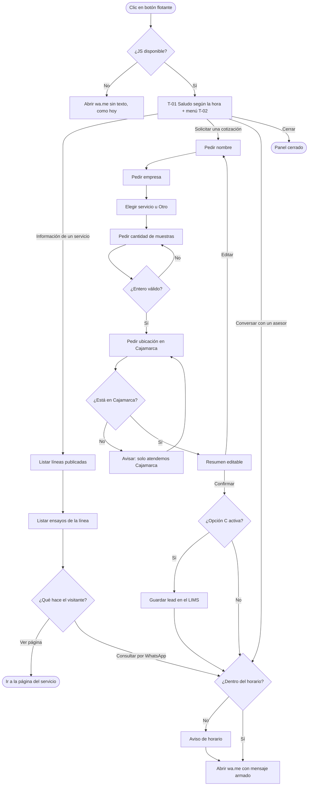
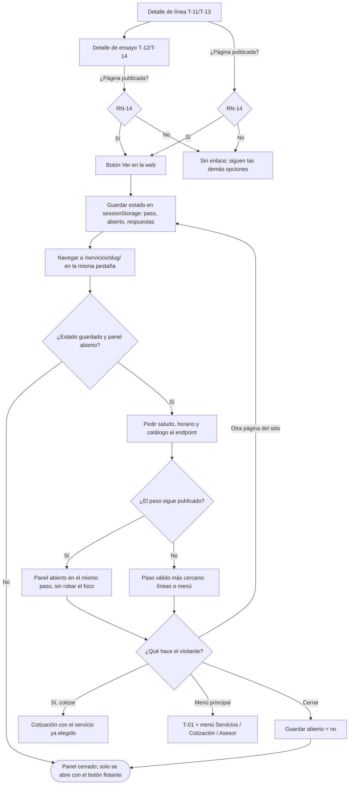

# VCF-WEB · Web institucional (asistente de WhatsApp y certificaciones) · HU / CU / RN

| Proyecto | Módulo | Doc | Versión | Fecha | Dueño (ASP) | Estado | Gate |
|---|---|---|---|---|---|---|---|
| Grupo VICAF (VCF) | VCF-WEB | VCF-WEB_HU_CU | v1.7 | 2026-10-23 | Fundador VQL | Aprobado | G1 aprobado por el Gerente (falta la confirmación de QA, ver PM-08); cambios de alcance v1.5 y v1.7 y requerimiento nuevo v1.6 [Decisión Gerente] |

> **v1.7 (2026-10-23) · Cambio de alcance [Decisión Gerente]:** cambia el concepto de certificaciones. Un solo modelo "Certificación" (acreditaciones, certificaciones ISO y otras) con título, descripción corta, tipo, institución, archivo (imagen o PDF), vigencia opcional, orden y activo; la acreditación INACAL LE-230 y el certificado ISO 9001 pasan a ese modelo. `/acreditacion/` muestra una grilla de cards debajo del hero y cada card abre el documento en un modal; la home muestra una versión resumida (máximo 4 cards y "Ver todas") y deja de mostrar la imagen grande del certificado. Se corrigen los textos "del norte del Perú" de la home y de Acreditación (D-VCF-002). HU-WEB-08 y CU-WEB-04 se reescriben; RN-15 cambia. Ver la sección 2.5 y P-16 a P-18.
>
> **v1.6 (2026-10-23) · Requerimiento nuevo [Decisión Gerente]:** mostrar el certificado ISO 9001 de Grupo VICAF (AENOR, ER-0146/2026) en /acreditacion/, junto a INACAL, con visor del PDF en un modal (pestaña nueva en móvil), PDF y vigencia cargados desde el admin y la certificación en el JSON-LD. Ver HU-WEB-08, CU-WEB-04, RN-15 y las preguntas P-12 a P-15.
>
> **v1.5 (2026-10-23) · Cambio de alcance [Decisión Gerente]:** enlaces "Ver en la web" desde el asistente, panel que sigue abierto al navegar, botón fijo al menú principal, cierre que no se reabre solo y panel usable en móvil. Ver HU-WEB-07, CA-02.3, CA-02.7, RN-12, RN-13 y la sección 8.1.
>
> Requerimiento nuevo pedido por Juan Carlos Núñez Rodrigo el 2026-10-15. Todavía sin código. Las reglas sin validar llevan **[Propuesto]** o **[Supuesto]**; nada de este doc está aprobado por el Gerente.
>
> Fuente técnica: snapshot del repo `grupovicaf-main.zip` (rama `main`, 7 oct 2026). No se pudo leer la rama `dev` porque GitHub no está vinculado a la sesión; lo que diga `dev` puede diferir.

## 1. Objetivo
Convertir el botón flotante de WhatsApp de la web institucional en un **asistente guiado** que salude al visitante, le pregunte si busca **información de un servicio** o una **cotización**, y en ambos casos termine abriendo WhatsApp con un mensaje ya armado. [Validado con usuario]

Alcance geográfico: solo Cajamarca (D-VCF-002). [Decisión Gerente]

## 2. Situación actual (revisión del repo)

### 2.1 Botón flotante de WhatsApp
| Hecho | Dónde | Origen |
|---|---|---|
| El botón flotante existe **solo en la home**, no en `web/base.html`; en las demás páginas no aparece | `templates/web/home.html:455-465` | [Propuesto] (leído del código) |
| Es un enlace estático `https://wa.me/{{ negocio.whatsapp }}` sin texto pre-armado (`?text=`) y sin JavaScript | `templates/web/home.html:456` | [Propuesto] |
| Estilo: círculo verde `bg-emerald-600`, `fixed bottom-5 right-5 z-40`, ícono SVG, `aria-label="Escríbenos por WhatsApp"` | `templates/web/home.html:457-458` | [Propuesto] |
| El número sale de `siteconfig.NegocioConfig.whatsapp` vía context processor `negocio` (fuente única NAP) | `siteconfig/models.py:28`, `siteconfig/context_processors.py:4` | [Propuesto] |
| La home no limpia el `+` del número; contacto sí lo hace con `cut:'+'|cut:' '|cut:'-'`. `wa.me` espera solo dígitos | `home.html:456` vs `contacto.html:205` | [Supuesto] posible enlace roto en algunos clientes |
| Hay otro botón "Escribir por WhatsApp" en la sección de contacto de la home y en `/contacto/` | `home.html:418-420`, `contacto.html:204-207` | [Propuesto] |

### 2.2 Datos de servicios disponibles en el LIMS
| Fuente | Campos útiles para el asistente | Observación | Origen |
|---|---|---|---|
| `servicios.Servicio` (catálogo interno) | `codigo_facturacion`, `nombre`, `norma`, `metodo`, `unidad_base`, `precio_base`, `esta_acreditado` | 98 ensayos en `cargar_servicios.py` (prefijos EA, EQ, ES, ED, EU, CN, EE, EG, CE, TC, ER, EC). `esta_acreditado` está mal poblado (96 de 99 marcados) según `siteconfig/models.py`, así que no sirve para mostrar "acreditado" | [Propuesto] |
| `servicios.CategoriaServicio` / `Subcategoria` | `nombre` | Agrupación interna del LIMS | [Propuesto] |
| `web_catalogo.LineaServicio` | `nombre`, `resumen`, `slug`, `orden`, `activo`, M2M `ensayos` → `Servicio` | Las 8 líneas comerciales de la web; `publicadas()` filtra `activo=True` | [Propuesto] |
| `web_catalogo.ServicioPublicado` | `titulo_publico`, `resumen`, `linea`, `slug`, `orden`, `activo` (OneToOne a `Servicio`) | Ensayos con página pública propia; `publicados()` filtra `activo=True` | [Propuesto] |
| `web_contacto.SolicitudCotizacionWeb` + `SolicitudCotizacionItem` | `ruc`, `razon_social`, `persona_contacto`, `correo_contacto`, `telefono_contacto`, `necesidad`, `origen`, ítems con `servicio_publicado` y `cantidad_estimada` | Ya existe un flujo web → LIMS: `web_contacto.services.procesar_solicitud_cotizacion` crea o reutiliza el `Cliente` por RUC y genera una `Cotizacion` real en estado Pendiente | [Propuesto] |

Regla del repo que aplica: toda vista pública usa **lista blanca de campos** (`CLAUDE.md`, reglas 1-3). [Propuesto]

### 2.3 Página de acreditación (v1.6)
| Hecho | Dónde | Origen |
|---|---|---|
| `/acreditacion/` lista los registros `Acreditacion` (INACAL) y abre por clic un modal con la **imagen** del certificado INACAL; no hay nada de ISO 9001 | `templates/web/acreditacion.html`, `web/partials/modal_certificado_inacal.html` | [Propuesto] (leído del código) |
| `Acreditacion` modela una acreditación de laboratorio (organismo, N.º, alcance, ensayos acreditados); una certificación de sistema de gestión es otra cosa (norma, organismo certificador, sede) | `web_acreditacion/models.py` | [Propuesto] |
| nginx manda `X-Frame-Options: DENY` en todo `www`, también en `/media/`, y Django hace lo mismo en dev: un PDF de `/media/` no se puede embeber en un `<iframe>` de la propia web | `deploy/nginx/grupovicaf.conf:82`, `XFrameOptionsMiddleware` | [Propuesto] (leído del código) |

### 2.4 Datos del certificado ISO 9001 (leídos del PDF)
*(v1.7: estos datos se resumen en el título y la descripción de la card; norma, N.º, alcance, sede, fecha de emisión y sello dejan de ser campos propios, ver 2.5.)*

El PDF `CertificadoER-0146-2026_IN_2026-04-06.pdf` es una imagen sin texto extraíble; los datos se leyeron de la página renderizada y se cotejaron con la versión en español (`CertificadoER-0146-2026_ES_2026-04-06.pdf`).

| Dato | Valor | Origen |
|---|---|---|
| Norma | ISO 9001:2015 · Sistema de Gestión de la Calidad | Leído del PDF |
| N.º de certificado | ER-0146/2026 | Leído del PDF |
| Organismo certificador | AENOR CONFIA S.A.U. (AENOR Perú) | Leído del PDF |
| Organización | GRUPO VICAF S.A.C. | Leído del PDF |
| Alcance | "Servicios de estudios de mecánica de suelos para proyectos de construcción e infraestructura." (versión ES). La versión EN dice "mechanical engineering studies", que no es lo mismo | Leído del PDF · ver P-13 |
| Sede | Jr. Los Topacios 440, Cajamarca (Perú) | Leído del PDF |
| Primera emisión | 2026-04-01 | Leído del PDF · ver P-12 (el requerimiento dice 2026-04-06) |
| Vigencia (expiración) | 2029-04-01 | Leído del PDF |
| Sello | Marca AENOR "Gestión de la Calidad · ISO 9001" | Leído del PDF · uso en la web [Supuesto], ver P-14 |

### 2.5 Migración al modelo único (v1.7)
| Registro | Título | Tipo | Institución | Archivo | Vigencia | Origen |
|---|---|---|---|---|---|---|
| INACAL | Acreditación INACAL LE-230 | Acreditación | Instituto Nacional de Calidad (INACAL) | Imagen del certificado que hoy muestra la web (`static/web/img/certificaciones/GRUPO-VICAF-CERTIFICADO.webp`), copiada a `/media/certificaciones/` | 2027-05-27 (leído de la imagen: "Fecha de Vencimiento: 27 de mayo de 2027") | [Decisión Gerente] (migrar) / Leído del certificado (vigencia) |
| ISO 9001 | Certificación ISO 9001:2015 | Certificación ISO | AENOR CONFIA S.A.U. | El PDF ya cargado se conserva; si no hay PDF, la card no aparece hasta subirlo | 2029-04-01 | [Decisión Gerente] (migrar) / sección 2.4 |

La descripción corta de cada uno se arma con los datos de 2.4 y del certificado INACAL (norma, N.º de registro o de certificado) [Propuesto]. El modelo `Acreditacion` (alcance y ensayos acreditados) no cambia: sigue alimentando la lista de ensayos de `/acreditacion/` y la revinculación del catálogo; solo deja de ser la fuente del certificado [Supuesto] (ver P-16).

## 3. Actores
| Actor | Descripción | Origen |
|---|---|---|
| Visitante | Persona que entra a `www.grupovicaf.com`; puede ser cliente nuevo o recurrente | [Validado con usuario] |
| Área comercial | Quien atiende el WhatsApp del laboratorio y prepara la oferta (FOR-001) | [Supuesto] |
| Administrador web | Mantiene `NegocioConfig`, líneas y servicios publicados desde el admin; desde v1.6 también sube el PDF, el sello y la vigencia de las certificaciones; desde v1.7, el archivo (imagen o PDF), el tipo y la vigencia opcional de cada certificación | [Propuesto] |

## 4. Historias de usuario

### HU-WEB-01 · Saludo y elección de intención
**Como** visitante, **quiero** que el botón de WhatsApp me salude y me pregunte qué busco, **para** llegar rápido a lo que necesito. [Validado con usuario]

Criterios de aceptación (EARS):
- **CA-01.1** CUANDO el visitante haga clic en el botón flotante, EL SISTEMA DEBE abrir el panel del asistente con el saludo T-01 y tres opciones: "Ver nuestros servicios", "Solicitar una cotización" y "Conversar con un asesor". [Validado con usuario] (v1: dos opciones) / [Propuesto] (ASP, v1.3: tercera opción)
- **CA-01.2** CUANDO el visitante cierre el panel, EL SISTEMA DEBE ocultarlo y mantener visible el botón flotante. [Propuesto]
- **CA-01.3** SI el navegador no ejecuta JavaScript, ENTONCES EL SISTEMA DEBE mantener el botón como enlace directo a WhatsApp, igual que hoy. [Propuesto]
- **CA-01.4** DONDE el visitante navegue con teclado, EL SISTEMA DEBE permitir abrir, recorrer y cerrar el asistente con Tab, Enter y Esc. [Propuesto]
- **CA-01.6** CUANDO el asistente se abra, EL SISTEMA DEBE saludar según la hora de Cajamarca (America/Lima): "buenos días" de 05:00 a 11:59, "buenas tardes" de 12:00 a 18:59 y "buenas noches" de 19:00 a 04:59, y dar la bienvenida a Grupo VICAF con el texto de la sección 7.1. [Validado con usuario] (saludo por horario y bienvenida) / [Propuesto] (franjas y texto)
- **CA-01.7** CUANDO el asistente arme el mensaje de WhatsApp, EL SISTEMA DEBE iniciarlo con el mismo saludo según la hora ("Hola, buenas tardes, …"). [Propuesto]
- **CA-01.5** EL SISTEMA DEBE mostrar el botón flotante en todas las páginas públicas, no solo en la home. [Decisión Gerente]

### HU-WEB-06 · Conversar con un asesor
**Como** visitante, **quiero** pasar directo a hablar con una persona, **para** no responder preguntas si ya sé lo que necesito. [Propuesto] (ASP)

- **CA-06.1** CUANDO el visitante elija "Conversar con un asesor", EL SISTEMA DEBE mostrar el texto T-30 y un botón que abra WhatsApp al número de `NegocioConfig.whatsapp` con el mensaje de asesor de la sección 7.5. [Propuesto]
- **CA-06.2** CUANDO el visitante elija "Conversar con un asesor" fuera del horario de atención, EL SISTEMA DEBE mostrar antes el aviso T-40. [Propuesto]

### HU-WEB-07 · Seguir con el asistente mientras navego la web
**Como** visitante, **quiero** abrir la página de un servicio desde el asistente y que el panel siga abierto donde lo dejé, **para** leer el detalle sin perder la conversación ni tener que empezar de nuevo. [Decisión Gerente] (v1.5)

- **CA-07.1** MIENTRAS el panel esté abierto, CUANDO el visitante pase a otra página de la web (por "Ver en la web" o por el menú del sitio), EL SISTEMA DEBE mostrar el panel abierto en la nueva página, en el mismo paso de la conversación y con las respuestas ya dadas. [Decisión Gerente]
- **CA-07.2** MIENTRAS el panel muestre un paso distinto del menú, EL SISTEMA DEBE mostrar siempre el botón "Menú principal", que vuelve al saludo T-01 con las opciones Servicios / Cotización / Asesor. [Decisión Gerente]
- **CA-07.3** CUANDO el visitante elija "Sí, cotizar" en el detalle de un servicio, también después de haber navegado, EL SISTEMA DEBE iniciar la cotización con ese servicio ya elegido (se salta T-23). [Decisión Gerente]
- **CA-07.4** CUANDO el visitante cierre el panel (botón × o Esc), EL SISTEMA NO DEBE volver a abrirlo por su cuenta ni en esa página ni en las siguientes; solo se abre al pulsar el botón flotante. [Decisión Gerente]
- **CA-07.5** CUANDO el visitante vuelva a abrir el panel durante la misma sesión, EL SISTEMA DEBE retomar el último paso en el que estaba. [Propuesto] (ASP, deriva de CA-07.1)
- **CA-07.6** DONDE la pantalla tenga menos de 640 px de ancho, EL SISTEMA DEBE mostrar el panel a lo ancho con márgenes de 16 px, con altura máxima cercana a la mitad de la pantalla, sin capa que bloquee la página, y dejar desplazar la página para leer todo su contenido por encima del panel. En escritorio el comportamiento es el mismo, con el panel en la esquina inferior derecha. [Decisión Gerente]
- **CA-07.7** SI el navegador no permite guardar el estado (modo privado estricto, almacenamiento bloqueado), ENTONCES EL SISTEMA DEBE seguir funcionando como en v1.4, sin restaurar el panel entre páginas. [Propuesto]

### HU-WEB-02 · Información de servicios
**Como** visitante, **quiero** ver los servicios del laboratorio dentro del asistente, **para** saber si hacen lo que necesito antes de escribir. [Validado con usuario]

- **CA-02.1** CUANDO el visitante elija "Información de un servicio", EL SISTEMA DEBE listar las líneas de servicio publicadas (`LineaServicio.activo=True`) en el orden configurado. [Validado con usuario] (fuente LIMS) / [Propuesto] (usar líneas como primer nivel)
- **CA-02.2** CUANDO el visitante elija una línea, EL SISTEMA DEBE listar sus ensayos con nombre público y resumen, tomando solo `ServicioPublicado` activos. [Propuesto]
- **CA-02.3** CUANDO el visitante elija una línea o un ensayo, EL SISTEMA DEBE ofrecer el enlace "Ver en la web" a su página real en `/servicios/<slug>/` (URL de `LineaServicio` o de `ServicioPublicado`), que se abre en la misma pestaña, y en el ensayo también "Consultar por WhatsApp". [Decisión Gerente] (v1.5; antes "Ver página del servicio", solo en ensayos)
- **CA-02.7** SI una línea o un ensayo no tiene página publicada, ENTONCES EL SISTEMA NO DEBE mostrar el enlace "Ver en la web" y DEBE mantener las demás opciones. [Decisión Gerente] (v1.5)
- **CA-02.4** CUANDO el visitante elija "Consultar por WhatsApp", EL SISTEMA DEBE abrir WhatsApp con un mensaje que nombre el servicio elegido. [Validado con usuario]
- **CA-02.5** EL SISTEMA NO DEBE mostrar precios, códigos de facturación ni la marca de acreditado en el asistente. [Propuesto] — ver RN-04 y P-06
- **CA-02.6** SI una línea no tiene ensayos publicados, ENTONCES EL SISTEMA DEBE mostrar la línea con su resumen y la opción de consultar por WhatsApp. [Propuesto]

### HU-WEB-03 · Datos para cotización
**Como** visitante que necesita una cotización, **quiero** dar mis datos en unas pocas preguntas, **para** que el laboratorio me responda sin pedírmelos de nuevo. [Validado con usuario]

- **CA-03.1** CUANDO el visitante elija "Solicitar una cotización", EL SISTEMA DEBE pedir, en este orden: nombre, empresa, servicio, cantidad de muestras y ubicación en Cajamarca. [Validado con usuario]
- **CA-03.2** CUANDO el sistema pida el servicio, EL SISTEMA DEBE ofrecer la lista de líneas/servicios publicados y una opción "Otro / no sé" con texto libre. [Propuesto]
- **CA-03.3** SI la cantidad de muestras no es un entero entre 1 y 999, ENTONCES EL SISTEMA DEBE mostrar un aviso y no avanzar. [Propuesto] — tope por confirmar (P-05)
- **CA-03.4** SI el nombre o el servicio están vacíos, ENTONCES EL SISTEMA DEBE impedir avanzar y señalar el campo. [Propuesto]
- **CA-03.5** DONDE el visitante sea persona natural, EL SISTEMA DEBE permitir dejar "Empresa" vacío con el botón «Omitir». [Decisión Gerente]
- **CA-03.6** CUANDO el sistema pida la ubicación, EL SISTEMA DEBE aceptar solo ubicaciones dentro de Cajamarca (lista de distritos o texto libre con la indicación "en Cajamarca"). [Validado con usuario] / [Propuesto] (forma de captura, P-03)
- **CA-03.7** MIENTRAS el visitante esté respondiendo, EL SISTEMA DEBE permitirle volver al paso anterior sin perder lo ya escrito. [Propuesto]
- **CA-03.8** CUANDO el visitante complete los datos, EL SISTEMA DEBE mostrar un resumen editable antes de abrir WhatsApp. [Propuesto]

### HU-WEB-04 · Mensaje pre-armado en WhatsApp
**Como** visitante, **quiero** que al final se abra WhatsApp con mi mensaje ya escrito, **para** solo tener que enviarlo. [Validado con usuario]

- **CA-04.1** CUANDO el visitante confirme el resumen, EL SISTEMA DEBE abrir `https://wa.me/<número>?text=<mensaje>` en una pestaña nueva, con el número de `NegocioConfig.whatsapp` reducido a dígitos. [Validado con usuario] / [Propuesto] (formato técnico)
- **CA-04.2** EL SISTEMA DEBE codificar el mensaje para URL de forma que tildes, ñ y saltos de línea lleguen intactos a WhatsApp. [Propuesto]
- **CA-04.3** EL SISTEMA DEBE armar el mensaje con la plantilla vigente (sección 7) e incluir todas las respuestas del visitante. [Validado con usuario]
- **CA-04.4** SI `NegocioConfig.whatsapp` está vacío, ENTONCES EL SISTEMA NO DEBE mostrar el botón ni el asistente. [Propuesto] (mantiene el comportamiento actual)
- **CA-04.5** CUANDO el asistente abra WhatsApp fuera del horario de atención, EL SISTEMA DEBE mostrar antes el aviso T-40 con `{horario_atencion}`. [Decisión Gerente] (horario de P-02)

### HU-WEB-05 · Registro de la cotización como lead (solo si se elige la opción C)
**Como** área comercial, **quiero** que cada cotización del asistente quede registrada en el LIMS, **para** no perder pedidos que llegan por WhatsApp. [Propuesto] — depende de la Decisión propuesta DP-WEB-01

- **CA-05.1** CUANDO el visitante confirme el resumen de cotización, EL SISTEMA DEBE guardar un lead con sus respuestas, la página de origen y la fecha, antes de abrir WhatsApp. [Propuesto]
- **CA-05.2** SI falla el guardado del lead, ENTONCES EL SISTEMA DEBE abrir WhatsApp igualmente. [Propuesto]
- **CA-05.3** EL SISTEMA DEBE limitar el registro por IP con el mismo `rate_limit` y honeypot que `/contacto/cotizacion/`. [Propuesto]
- **CA-05.4** EL SISTEMA NO DEBE crear un `Cliente` ni una `Cotizacion` real desde el lead sin que un usuario del LIMS lo revise. [Propuesto] — ver Observación PM-04

### HU-WEB-08 · Ver las acreditaciones y certificaciones del laboratorio (v1.7)
**Como** visitante que evalúa contratar al laboratorio, **quiero** ver en una grilla las acreditaciones y certificaciones de Grupo VICAF y abrir cada documento, **para** comprobar que sus ensayos y su gestión están respaldados por instituciones independientes. [Decisión Gerente]

*(v1.7 reemplaza la versión v1.6 de esta HU: la tarjeta ISO 9001 con todos sus datos y el visor solo de PDF pasan a una card uniforme para cualquier certificación y un modal para imagen o PDF.)*

Criterios de aceptación (EARS):
- **CA-08.1** MIENTRAS existan certificaciones publicadas (RN-15), EL SISTEMA DEBE mostrar en `/acreditacion/`, debajo del hero, una grilla de cards en el orden del admin: 4 columnas en escritorio, 2 en tablet y 1 en móvil. [Decisión Gerente]
- **CA-08.2** EL SISTEMA DEBE mostrar en cada card el título, la descripción corta, el tipo como etiqueta y la institución que la otorga, con el mismo diseño y alto para todas las cards de una fila, y sin la imagen del certificado. [Decisión Gerente] (contenido) / [Propuesto] (mismo alto)
- **CA-08.3** CUANDO el visitante haga clic en una card (o la active con el teclado) y su archivo sea una imagen, EL SISTEMA DEBE abrir un modal con la imagen. [Decisión Gerente]
- **CA-08.4** CUANDO el visitante abra una card cuyo archivo sea PDF en un equipo de escritorio (pantalla de 768 px o más, puntero fino y visor de PDF del navegador), EL SISTEMA DEBE abrir el modal con el PDF embebido. DONDE el equipo sea un móvil o tableta, o el navegador no tenga visor de PDF o no ejecute JavaScript, EL SISTEMA DEBE abrir el PDF en una pestaña nueva. [Decisión Gerente] (pestaña nueva en móvil) / [Propuesto] (criterio de escritorio, igual que v1.6)
- **CA-08.5** MIENTRAS el modal esté abierto, EL SISTEMA DEBE mostrar los botones "Descargar" (descarga el mismo archivo) y "Cerrar", y cerrarse con "Cerrar", ×, Esc o un clic fuera del contenido, devolviendo el foco a la card que lo abrió. [Decisión Gerente]
- **CA-08.6** MIENTRAS el modal esté abierto, EL SISTEMA DEBE anunciarse como diálogo modal (`role="dialog"`, `aria-modal="true"`, título accesible), mantener el foco dentro del modal y bloquear el desplazamiento de la página. [Decisión Gerente] ("accesible")
- **CA-08.7** SI una certificación está inactiva, venció (fecha de vigencia anterior a la fecha de Lima) o no tiene archivo, ENTONCES EL SISTEMA NO DEBE mostrar su card en ninguna página ni declararla en los datos estructurados. [Decisión Gerente]
- **CA-08.8** MIENTRAS existan certificaciones publicadas, EL SISTEMA DEBE mostrar en la home una sección resumida con las mismas cards, como máximo 4, y el enlace "Ver todas" a `/acreditacion/`. [Decisión Gerente]
- **CA-08.9** EL SISTEMA NO DEBE mostrar en la home la imagen grande del certificado. [Decisión Gerente]
- **CA-08.10** EL SISTEMA DEBE permitir al administrador web crear y editar certificaciones desde el admin con: título, descripción corta, tipo (Acreditación / Certificación ISO / Otro), institución que la otorga, archivo (imagen o PDF), fecha de vigencia opcional, orden y activo, sin cambios de código. [Decisión Gerente]
- **CA-08.11** MIENTRAS haya certificaciones publicadas de tipo "Certificación ISO" u "Otro", EL SISTEMA DEBE declararlas en el JSON-LD de la organización (`LocalBusiness.hasCertification`); la acreditación INACAL sigue declarada como `hasCredential`. [Propuesto]
- **CA-08.12** EL SISTEMA NO DEBE decir en la home ni en `/acreditacion/` que el laboratorio opera en el "norte del Perú": el alcance es solo Cajamarca. [Decisión Gerente] D-VCF-002

## 5. Casos de uso

### CU-WEB-01 · Consultar un servicio
| Campo | Detalle |
|---|---|
| Actor | Visitante |
| Precondición | `NegocioConfig.whatsapp` configurado; hay líneas publicadas |
| Flujo básico | 1. Clic en el botón flotante. 2. El sistema saluda y ofrece dos opciones. 3. Elige "Información de un servicio". 4. El sistema lista líneas. 5. Elige una línea. 6. El sistema lista sus ensayos. 7. Elige un ensayo. 8. Elige "Consultar por WhatsApp". 9. El sistema abre WhatsApp con el mensaje armado |
| Alternos | 6a. Línea sin ensayos publicados: ofrece consultar la línea (CA-02.6). 5a/7a. Elige "Ver en la web": navega a la página de la línea o del ensayo y el panel sigue abierto en el mismo paso (CU-WEB-03). *a. Cierra el panel en cualquier paso; no se reabre solo. *b. "Menú principal" en cualquier paso: vuelve a T-01 |
| Postcondición | WhatsApp abierto con el mensaje; nada se guarda (opción A) |
| HU | HU-WEB-01, 02, 04, 07 |

### CU-WEB-03 · Ver un servicio en la web sin perder el asistente
| Campo | Detalle |
|---|---|
| Actor | Visitante |
| Precondición | Panel abierto en el detalle de una línea o de un ensayo con página publicada |
| Flujo básico | 1. Elige "Ver en la web". 2. El navegador abre `/servicios/<slug>/` en la misma pestaña. 3. El sistema recupera el estado guardado en la sesión del navegador. 4. El sistema vuelve a pedir saludo, horario y catálogo al endpoint. 5. El sistema muestra el panel abierto en el mismo paso, sin mover el foco ni el desplazamiento de la página. 6. El visitante lee la página y sigue con "Sí, cotizar", "Consultar por WhatsApp", "Volver" o "Menú principal" |
| Alternos | 3a. No hay estado o el panel estaba cerrado: el panel queda cerrado (CA-07.4). 3b. El almacenamiento no está disponible: se comporta como v1.4 (CA-07.7). 4a. La línea o el ensayo ya no está publicado: el sistema muestra el paso válido más cercano (lista de líneas o menú). 4b. Falla el endpoint: muestra el aviso de carga y el enlace directo a WhatsApp |
| Postcondición | Panel abierto en el mismo paso, en la página del servicio |
| HU | HU-WEB-02, 07 |

### CU-WEB-02 · Solicitar una cotización
| Campo | Detalle |
|---|---|
| Actor | Visitante |
| Precondición | Igual a CU-WEB-01 |
| Flujo básico | 1-2. Igual a CU-WEB-01. 3. Elige "Solicitar una cotización". 4. Ingresa nombre. 5. Ingresa empresa. 6. Elige servicio. 7. Ingresa cantidad de muestras. 8. Ingresa ubicación en Cajamarca. 9. El sistema muestra el resumen. 10. Confirma. 11. (Opción C) el sistema guarda el lead. 12. El sistema abre WhatsApp con el mensaje |
| Alternos | 7a. Cantidad inválida: aviso y repite (CA-03.3). 8a. Ubicación fuera de Cajamarca: el sistema informa que solo se atiende Cajamarca y permite corregir (RN-02). 9a. Edita un dato desde el resumen. 11a. Falla el guardado: sigue al paso 12 (CA-05.2) |
| Postcondición | WhatsApp abierto; con opción C, lead registrado |
| HU | HU-WEB-01, 03, 04, 05 |

### CU-WEB-04 · Ver una acreditación o certificación (v1.7)
| Campo | Detalle |
|---|---|
| Actor | Visitante; Administrador web (precondición) |
| Precondición | El administrador web cargó la certificación con su archivo, la dejó activa y su vigencia (si tiene) no ha pasado (RN-15) |
| Flujo básico | 1. El visitante entra a `/acreditacion/` (o ve la sección resumida de la home). 2. El sistema muestra las cards. 3. El visitante hace clic en una card. 4. El sistema abre el modal con la imagen o el PDF y el foco en ×. 5. El visitante lo revisa, lo descarga con "Descargar" o cierra con "Cerrar", ×, Esc o clic fuera. 6. El sistema cierra el modal y devuelve el foco a la card |
| Alternos | 1a. En la home hay más de 4 publicadas: se muestran las 4 primeras y "Ver todas" lleva a `/acreditacion/` (CA-08.8). 3a. PDF en móvil, tableta o navegador sin visor de PDF: se abre en una pestaña nueva (CA-08.4). 3b. Sin JavaScript: cualquier archivo se abre en una pestaña nueva. 1b. Ninguna publicada: no se muestra la grilla ni la sección de la home (CA-08.7) |
| Postcondición | Nada se guarda |
| HU | HU-WEB-08 |

## 6. Reglas de negocio
| ID | Regla | Origen |
|---|---|---|
| RN-01 | El asistente es guiado (opciones y campos fijos); no responde texto libre ni simula una conversación con IA | [Propuesto] |
| RN-02 | Solo se atiende Cajamarca. El asistente no ofrece ni acepta ubicaciones de otras zonas | [Decisión Gerente] D-VCF-002 |
| RN-03 | El número de WhatsApp y el horario se leen de `NegocioConfig`; nunca se escriben en la plantilla o el JS | [Propuesto] (regla NAP del repo) |
| RN-04 | El asistente solo expone campos públicos con lista blanca: nombre/título público, resumen y slug. No expone precios, códigos de facturación, RUC ni datos de clientes | [Propuesto] (CLAUDE.md reglas 2-3) |
| RN-05 | La lista de servicios sale del LIMS vía `LineaServicio` y `ServicioPublicado` activos; no se duplica el catálogo | [Validado con usuario] (fuente LIMS) / [Propuesto] (modelos) |
| RN-06 | Datos de cotización obligatorios: nombre, servicio, cantidad de muestras y ubicación. Empresa por confirmar | [Validado con usuario] / [Supuesto] (obligatoriedad) |
| RN-07 | El mensaje final lo envía el visitante desde su WhatsApp; el sistema no envía mensajes por su cuenta (opciones A y C) | [Propuesto] |
| RN-08 | Con la opción C, el lead no es una cotización: la oferta formal (FOR-001, VCF-OTE-AAAA-NNN) la sigue generando el área comercial en el LIMS | [Propuesto] |
| RN-10 | La franja del saludo se calcula con la hora de Lima, no con la del servidor, para que coincida con la del visitante en Cajamarca | [Propuesto] |
| RN-09 | Los textos del asistente tratan al visitante de "usted", con tono profesional y cordial, a nombre de Grupo VICAF | [Propuesto] (ASP) |
| RN-11 | Cada mensaje del asistente tiene 3 líneas como máximo, sin precios, sin zonas fuera de Cajamarca y con un emoji como máximo | [Propuesto] (ASP) |
| RN-12 | El estado del asistente (paso, panel abierto o cerrado y respuestas) se guarda solo en el navegador del visitante, en `sessionStorage`, y se borra al cerrar la pestaña. Nunca se envía al servidor (opción A) | [Decisión Gerente] (v1.5) |
| RN-13 | El asistente solo se abre por acción del visitante. Al pasar de página se restaura abierto únicamente si el visitante lo dejó abierto; si lo cerró, sigue cerrado | [Decisión Gerente] (v1.5) |
| RN-14 | "Ver en la web" se muestra solo si la línea o el ensayo tiene página publicada: activo y con su slug resolviendo a esa misma página en `/servicios/<slug>/` | [Decisión Gerente] (v1.5) |
| RN-15 | Una certificación (de cualquier tipo) solo se publica en la web, en las cards, el modal y el JSON-LD, si está activa, tiene archivo cargado y, si tiene fecha de vigencia, esa fecha no ha pasado según la fecha de Lima. Sin fecha de vigencia no vence. El día del vencimiento todavía se muestra; desde el día siguiente desaparece sola, sin intervención del administrador | [Decisión Gerente] (v1.6, v1.7: vigencia opcional) / [Propuesto] (día de vencimiento inclusive, P-15) |

## 7. Textos del asistente

Redactados a pedido del ASP el 2026-10-15, a nombre de Grupo VICAF, con tono profesional, cordial y de "usted". **Textos aprobados por el Gerente en G1 (2026-10-15). [Decisión Gerente]** En el saludo T-01 se mantiene "acreditado por INACAL", porque la acreditación LE-230 está vigente y la web ya la muestra.

Reglas de redacción, propuestas por el ASP: mensajes de 3 líneas como máximo, sin precios, sin zonas fuera de Cajamarca y con un emoji por mensaje como máximo, solo si suma (RN-11). Las variables van entre llaves: `{saludo}` = Buenos días / Buenas tardes / Buenas noches según la hora de Lima (CA-01.6); `{horario_atencion}` = "lunes a viernes de 8:00 a 13:00 y de 15:00 a 18:00, sábados de 8:00 a 13:00" (P-02, [Decisión Gerente]), leído de `NegocioConfig`.

### 7.1 Saludo y menú
| ID | Momento | Texto |
|---|---|---|
| T-01 | Al abrir el asistente | {saludo}, bienvenido a Grupo VICAF 👋<br>Somos un laboratorio de suelos acreditado por INACAL en Cajamarca.<br>¿En qué podemos ayudarle? |
| T-02 | Menú (botones) | **1) Ver nuestros servicios** · **2) Solicitar una cotización** · **3) Conversar con un asesor** |

### 7.2 Opción 1 · Ver nuestros servicios
En todos los pasos salvo el menú, la cabecera del panel muestra el botón **Menú principal** (v1.5, CA-07.2).

| ID | Momento | Texto |
|---|---|---|
| T-10 | Introducción | Con gusto le mostramos nuestros servicios.<br>Elija una línea para ver los ensayos que realizamos. |
| — | Lista de líneas | Botón por cada `LineaServicio` activa, en el orden del admin: **nombre** + `resumen` en una línea. Sin precios ni códigos (RN-04) |
| T-11 | Tras elegir una línea | Estos son los ensayos de {línea}.<br>Toque uno para ver su detalle.<br>Botón: **Ver en la web** (página de la línea, si está publicada, v1.5) |
| — | Lista de ensayos | Botón por cada `ServicioPublicado` activo de esa línea: **titulo_publico** + `resumen` |
| T-12 | Detalle del ensayo | {titulo_publico}: {resumen}<br>Botones: **Ver en la web** (solo si tiene página publicada, v1.5) · **Consultar por WhatsApp** |
| T-13 | Línea sin ensayos publicados | Pronto publicaremos el detalle de esta línea.<br>Mientras tanto, puede consultarnos directamente.<br>Botones: **Ver en la web** (si la línea tiene página, v1.5) · **Consultar por WhatsApp** · **Solicitar una cotización** |
| T-14 | Cierre | ¿Desea que le preparemos una cotización para este servicio?<br>Solo le tomará un minuto.<br>Botones: **Sí, cotizar** · **Volver a servicios** |

### 7.3 Opción 2 · Solicitar una cotización
Se pregunta una cosa por vez. Si el visitante viene de T-14, el servicio ya llega elegido y se salta T-23.

| ID | Momento | Texto |
|---|---|---|
| T-20 | Introducción | Con gusto le preparamos una cotización.<br>Le haremos cinco preguntas breves. |
| T-21 | Nombre | ¿Cuál es su nombre?<br>*(campo: "Nombre y apellido")* |
| T-22 | Empresa | Gracias, {nombre}. ¿A qué empresa representa?<br>Si es persona natural, toque «Omitir». *(Empresa es opcional, P-04)* |
| T-23 | Servicio | ¿Qué servicio necesita?<br>*(lista de servicios publicados + "Otro / no estoy seguro")* |
| T-23b | Si elige "Otro" | Cuéntenos brevemente qué necesita ensayar. |
| T-24 | Cantidad | ¿Cuántas muestras desea ensayar?<br>*(campo numérico, ej.: 3)* |
| T-24e | Cantidad inválida | Por favor, ingrese un número entero mayor que cero. |
| T-25 | Ubicación | ¿En qué lugar de Cajamarca se encuentra su obra o proyecto?<br>*(campo de texto libre: "Distrito o referencia"; P-03 sigue abierta)* |
| T-25e | Ubicación fuera de Cajamarca | Por ahora atendemos solo proyectos en Cajamarca.<br>Si su proyecto está en Cajamarca, indíquenos el distrito o una referencia. |
| T-26 | Confirmación | Revise sus datos, por favor:<br>*(resumen: nombre, empresa, servicio, muestras, ubicación)*<br>¿Está todo correcto? Botones: **Enviar por WhatsApp** · **Corregir** |
| T-27 | Al abrir WhatsApp | Listo, abrimos WhatsApp con su solicitud; solo tiene que enviarla.<br>Un asesor le responderá a la brevedad. |

Excepción a la regla de 3 líneas: el resumen de T-26 es una lista de datos, no un mensaje.

### 7.4 Opción 3 · Conversar con un asesor
| ID | Momento | Texto |
|---|---|---|
| T-30 | Transferencia | Le comunicamos con uno de nuestros asesores por WhatsApp al +51 964 326 364.<br>El chat se abrirá en una nueva ventana.<br>Botón: **Abrir WhatsApp** |

### 7.5 Mensajes armados que se envían a WhatsApp
El visitante los envía desde su WhatsApp, así que van en primera persona.

Cotización:
```text
{saludo}, Grupo VICAF. Solicito una cotización:
• Nombre: {nombre}
• Empresa: {empresa | Persona natural}
• Servicio: {servicio}
• Cantidad de muestras: {cantidad}
• Ubicación: {ubicación}, Cajamarca
```
Servicio, desde T-12 o T-13:
```text
{saludo}, Grupo VICAF. Quisiera información sobre {servicio o línea}.
```
Asesor, desde T-30:
```text
{saludo}, Grupo VICAF. Quisiera conversar con un asesor.
```

### 7.6 Aviso fuera de horario
| ID | Momento | Texto |
|---|---|---|
| T-40 | Antes de abrir WhatsApp fuera de horario (CA-04.5) | Nuestro horario de atención es {horario_atencion}.<br>Puede dejarnos su mensaje y le responderemos el siguiente día hábil.<br>Botón: **Continuar a WhatsApp** |

### 7.7 Versiones cortas para WhatsApp Business
Se configuran en la app WhatsApp Business (Herramientas para la empresa) y no cambian según la hora. No requieren código.

| ID | Mensaje | Texto |
|---|---|---|
| T-50 | Mensaje de bienvenida | Hola, bienvenido a Grupo VICAF, laboratorio de suelos en Cajamarca 👋<br>Cuéntenos qué servicio necesita y le atenderemos a la brevedad. |
| T-51 | Mensaje de ausencia | Gracias por escribir a Grupo VICAF. En este momento estamos fuera de horario ({horario_atencion}).<br>Le responderemos el siguiente día hábil. |

En T-51, `{horario_atencion}` se escribe a mano en la app: "L-V 8:00-13:00 y 15:00-18:00, sáb. 8:00-13:00".

## 8. Flujo de la conversación



### 8.1 Navegación entre páginas con el asistente abierto (v1.5) [Decisión Gerente]



## 9. Decisión propuesta DP-WEB-01 · Tipo de asistente
Propuesta por Claude PM a pedido de Juan Carlos Núñez Rodrigo. **La decide el Gerente**; no está en REGISTRO_DECISIONES.

| Opción | Qué es | Pros | Contras |
|---|---|---|---|
| **A) Widget guiado → enlace de WhatsApp** | Panel en la web con opciones y campos; al final abre `wa.me?text=` | Sin costo mensual ni cuenta Business API. Cambio acotado a VCF-WEB (plantilla + JS + un endpoint de lectura). Sin datos personales guardados, así que no suma riesgo de protección de datos. Funciona con el número actual. Reversible | No queda registro en el sistema: si el visitante no envía el mensaje, el pedido se pierde. No hay métricas más allá de la analítica web. El visitante puede editar el mensaje antes de enviarlo |
| **B) Bot real con WhatsApp Business API** | El bot conversa dentro de WhatsApp (Meta Cloud API o proveedor como Twilio) | La conversación ocurre en WhatsApp, también para quien no pasa por la web. Puede responder 24/7 y guardar todo. Escalable a avisos de estado de informes | Requiere verificar la empresa en Meta, un número dedicado (el actual no podría usarse a la vez en la app normal) y plantillas aprobadas. Costo por conversación. Webhook público, tareas Celery y manejo de secretos (ya hay credenciales de Twilio escritas en `proyectos/utils.py`, que deberían salir a `.env` primero). Impacta VCF-INFRA. Mucho mayor alcance y plazo |
| **C) A + guardar cada cotización como lead en el LIMS** | Igual que A, y antes de abrir WhatsApp guarda las respuestas | Nada se pierde: el área comercial ve todos los pedidos aunque el visitante no envíe el mensaje. Permite medir conversión por página (`origen`). Reutiliza el patrón de `web_contacto` (honeypot, rate limit). Costo bajo | Guarda datos personales: hace falta aviso de privacidad y consentimiento. Toca el LIMS (modelo nuevo o cambio de `SolicitudCotizacionWeb`) y su bandeja. El modelo actual exige RUC, correo y teléfono, que el asistente no pide (PM-04). Más esfuerzo que A |

**Decisión del Gerente (2026-10-15): opción A, preparada para pasar a C.** Registrada como D-VCF-004. [Decisión Gerente]

Recomendación original del PM: **A ahora, diseñada para pasar a C** sin rehacerla (el JS arma un objeto con las respuestas que luego se puede enviar al servidor). B solo si el volumen de WhatsApp lo justifica.

## 10. Observaciones del PM
| ID | Observación | Impacto | Sugerencia |
|---|---|---|---|
| PM-01 | ~~Conflicto de número.~~ **Resuelto:** vale `+51 964 326 364`, el de `NegocioConfig` (`siteconfig/migrations/0003_seed_negocioconfig.py:26-27`). El +51 941 573 750 de la oferta VCF-OTE-2025-552 es incorrecto [Decisión Gerente] | Ninguno: el repo ya tiene el número correcto | Base de conocimiento corregida |
| PM-02 | ~~Conflicto de horario.~~ **Resuelto:** L-V 8:00-13:00 y 15:00-18:00, sáb 8:00-13:00 [Decisión Gerente]. `NegocioConfig` necesita campos para el receso de mediodía; se agregan en el diseño | — | Ver specs/WEB/design.md |
| PM-03 | **Conflicto con D-VCF-002.** `NegocioConfig.descripcion` dice "cobertura en el norte del Perú" y `ciudades_cobertura` incluye Jaén, Chota, Celendín, Bambamarca, Cajabamba y Cutervo | El asistente no debe leer esos datos; además ya se muestran en la meta description de la web | Avisar al Gerente; corregir en el admin, fuera del alcance de este requerimiento |
| PM-04 | `SolicitudCotizacionWeb` exige RUC, razón social, correo y teléfono, y crea un `Cliente` y una `Cotizacion` reales | La opción C no encaja tal cual: el asistente no pide esos datos | Si se elige C, un modelo `LeadWhatsApp` aparte o campos opcionales; decide el Gerente en diseño |
| PM-05 | `Servicio.esta_acreditado` está mal poblado (96 de 99) | Mostrar "acreditado" sería información falsa | No mostrarlo hasta depurar el alcance INACAL |
| PM-06 | El botón flotante solo está en la home y la home no limpia el `+` del número | Inconsistencia entre páginas y posible enlace fallido | Mover el componente a `web/base.html` (o un partial) en la spec; normalizar dígitos en un solo lugar |
| PM-07 | No pude leer la rama `dev` ni crear la rama y el commit: GitHub no está vinculado a la sesión | Puede haber cambios en `dev` que este análisis no ve | Vincular GitHub y repetir la revisión contra `dev` |

| PM-09 | *(v1.6)* nginx (`deploy/nginx/grupovicaf.conf`) y Django mandan `X-Frame-Options: DENY`, así que el PDF no se puede embeber. Se cambia a `SAMEORIGIN` **solo** para `/media/certificaciones/` | Al desplegar hay que copiar la config de nginx al servidor y recargarlo; si no, el modal se ve en blanco | Paso manual en el despliegue (ver specs/WEB/tasks.md, T15) |
| PM-10 | *(v1.6)* Las fechas y el alcance se leyeron de una imagen (el PDF no tiene texto). Hay discrepancias con el requerimiento (P-12, P-13) | Datos publicados con riesgo de error | El Gerente los confirma; se corrigen desde el admin sin código |
| PM-11 | *(v1.7)* Quedan textos "norte del Perú" fuera de la home y de Acreditación: `templates/web/clientes.html` y `NegocioConfig.descripcion` (meta description de la home, ver PM-03) | Siguen contradiciendo D-VCF-002 | Corregir `clientes.html` en otra tarea y la descripción desde el admin |
| PM-08 | G1 exige que QA confirme que los EARS se pueden probar. QA no está asignado, así que esa evidencia falta; el Gerente aprobó igual. P-03 (forma de captura de la ubicación) también seguía abierta y bloqueaba: se implementa la opción por defecto, texto libre | G1 queda con evidencia incompleta | Asignar QA o registrar la excepción |

## 11. Preguntas abiertas
| ID | Pregunta | Responsable | ¿Bloquea G1? |
|---|---|---|---|
| P-01 | ~~¿Cuál es el número de WhatsApp de atención?~~ **Cerrada:** +51 964 326 364, el que ya está en `NegocioConfig` [Decisión Gerente] (2026-10-15) | Gerente | No (cerrada) |
| P-02 | ~~Horario~~ **Cerrada:** L-V 8:00-13:00 y 15:00-18:00, sáb 8:00-13:00; se muestra el aviso fuera de horario [Decisión Gerente] | Gerente | No (cerrada) |
| P-03 | ¿La ubicación se pide como lista de distritos/provincias de Cajamarca o como texto libre? ¿Qué zonas de Cajamarca se atienden exactamente (solo la provincia o todo el departamento)? | Cliente | Sí |
| P-04 | ~~¿Empresa obligatoria?~~ **Cerrada:** opcional, con el botón «Omitir» [Decisión Gerente] | Gerente | No (cerrada) |
| P-05 | ¿Hay un tope razonable de cantidad de muestras? | Cliente | No |
| P-06 | ¿Se muestran precios referenciales en el asistente? (propuesta: no) | Gerente / cliente | No |
| P-07 | ~~¿Botón en todas las páginas?~~ **Cerrada:** sí, en todas las páginas de la web [Decisión Gerente] | Gerente | No (cerrada) |
| P-08 | ~~Textos del asistente~~ **Cerrada por el ASP (2026-10-15):** textos en la sección 7, en "usted" y con el saludo según la hora. Quedan [Propuesto] hasta que el Gerente los valide en G1. El horario sigue como variable (P-02) | ASP | No (cerrada) |
| P-09 | ~~¿Opción A, B o C?~~ **Cerrada:** A, preparada para C (D-VCF-004) [Decisión Gerente] | Gerente | No (cerrada) |
| P-10 | Si se elige C: ¿quién atiende los leads en el LIMS y qué texto de privacidad/consentimiento se muestra? | Gerente / cliente | Sí, solo con C |
| P-11 | En el flujo de servicio, ¿el primer nivel son las 8 líneas comerciales o las categorías del LIMS? (propuesta: líneas) | Gerente | No |
| P-12 | *(v1.6)* El requerimiento dice "emitido el 2026-04-06", pero el PDF dice "Primera emisión: 2026-04-01" (el 06-04 es la fecha en que AENOR generó el PDF). ¿Qué fecha se publica? Se cargó 2026-04-01 [Supuesto] | Gerente | No |
| P-13 | *(v1.6)* ¿Se publica el PDF en inglés (`_IN_`, pedido en el requerimiento) o el de español (`_ES_`)? La web está en español y el alcance en inglés dice "mechanical engineering studies" en vez de "mecánica de suelos". Propuesta: subir `_ES_`. El alcance de la tarjeta se cargó en español [Supuesto] | Gerente | No |
| P-14 | *(v1.6)* ¿El reglamento de uso de la marca AENOR permite mostrar el sello en la web tal como está? No se incluye en el código; si no se sube sello, la tarjeta muestra un distintivo de texto "ISO 9001" [Supuesto] | Gerente | No |
| P-15 | *(v1.6)* ¿El día del vencimiento (2029-04-01) todavía se muestra? Propuesta: sí, desaparece al día siguiente (RN-15) | Gerente | No |
| P-16 | *(v1.7)* El modelo `Acreditacion` (alcance y lista de ensayos acreditados de `/acreditacion/`) no se fusiona con "Certificación": tiene la relación con el catálogo del LIMS que una card no necesita. ¿Se mantiene esa sección debajo de la grilla? Se mantuvo [Supuesto] | Gerente | No |
| P-17 | *(v1.7)* Las descripciones cortas de INACAL e ISO 9001 se redactaron a partir de los certificados (sección 2.5). ¿Las valida el Gerente o las cambia desde el admin? [Propuesto] | Gerente | No |
| P-18 | *(v1.7)* Los botones INACAL del hero y de la franja de credibilidad de la home ("Ver certificado") abren ahora el mismo modal con el archivo de la certificación de tipo Acreditación; si no hay ninguna publicada, llevan a `/acreditacion/` [Supuesto] | Gerente | No |

## 12. Trazabilidad
| HU | CU | RN | Decisión |
|---|---|---|---|
| HU-WEB-01 | CU-WEB-01, CU-WEB-02 | RN-01, RN-03 | DP-WEB-01 |
| HU-WEB-02 | CU-WEB-01 | RN-04, RN-05 | — |
| HU-WEB-03 | CU-WEB-02 | RN-02, RN-06 | D-VCF-002 |
| HU-WEB-04 | CU-WEB-01, CU-WEB-02 | RN-03, RN-07 | DP-WEB-01 |
| HU-WEB-05 | CU-WEB-02 | RN-08 | DP-WEB-01 (solo C) |
| HU-WEB-06 | — | RN-09, RN-11 | — |
| HU-WEB-07 | CU-WEB-01, CU-WEB-03 | RN-12, RN-13, RN-14 | Cambio de alcance v1.5 [Decisión Gerente] |
| HU-WEB-08 | CU-WEB-04 | RN-15 | Requerimiento nuevo v1.6 y cambio de alcance v1.7 [Decisión Gerente]; D-VCF-002 (CA-08.12) |

Todos los criterios son verificables con prueba manual o E2E, salvo CA-02.5 y CA-04.2, que también requieren revisión de código.

## Historial
| Versión | Fecha | Cambio | Autor |
|---|---|---|---|
| v1 | 2026-10-15 | Versión inicial: revisión del botón y del catálogo en `main`, 5 HU con EARS, 2 CU, 9 RN, flujo Mermaid, DP-WEB-01 (A/B/C), 7 observaciones y 11 preguntas abiertas | Claude PM |
| v1.1 | 2026-10-15 | P-01 cerrada: el WhatsApp es +51 964 326 364 [Decisión Gerente]; PM-01 resuelta | Claude PM |
| v1.2 | 2026-10-15 | Saludo según el horario y bienvenida a Grupo VICAF [Validado con usuario]: CA-01.6, CA-01.7, RN-10 y textos de la sección 7.1 [Propuesto] | Claude PM |
| v1.3 | 2026-10-15 | El ASP pidió los textos: sección 7 "Textos del asistente" (T-01 a T-51), menú de 3 opciones, HU-WEB-06 (asesor), RN-09 en "usted", RN-11 y P-08 cerrada. Todo [Propuesto] hasta G1 | Claude PM |
| v1.4 | 2026-10-15 | G1: el Gerente aprueba las HU, la opción A (D-VCF-004) y los textos (se mantiene INACAL en T-01); cierra P-02, P-04, P-07 y P-09; se agrega PM-08 (falta QA y P-03 sigue abierta) | Claude PM |
| v1.5 | 2026-10-23 | Cambio de alcance [Decisión Gerente]: HU-WEB-07 (CA-07.1 a CA-07.7) y CU-WEB-03; CA-02.3 ajustado ("Ver en la web" en líneas y ensayos) y CA-02.7 nuevo; RN-12, RN-13 y RN-14; T-11, T-12 y T-13 con el enlace; flujo 8.1 en Mermaid. CA-07.5 y CA-07.7 quedan [Propuesto] | Claude PM |
| v1.6 | 2026-10-23 | Requerimiento nuevo [Decisión Gerente]: certificado ISO 9001 (AENOR, ER-0146/2026) en /acreditacion/. HU-WEB-08 (CA-08.1 a CA-08.7), CU-WEB-04, RN-15, secciones 2.3 y 2.4 (datos leídos del PDF), PM-09 y PM-10, P-12 a P-15. Supuestos marcados: fecha de emisión, idioma del PDF, uso del sello y día de vencimiento | Claude PM |
| v1.7 | 2026-10-23 | Cambio de alcance [Decisión Gerente]: modelo único "Certificación" (sección 2.5: migración de INACAL LE-230 e ISO 9001), HU-WEB-08 reescrita (CA-08.1 a CA-08.12: grilla de cards, modal de imagen o PDF, home resumida sin el certificado grande, textos solo Cajamarca), CU-WEB-04 reescrito, RN-15 con vigencia opcional, PM-11 y P-16 a P-18 | Claude PM |
