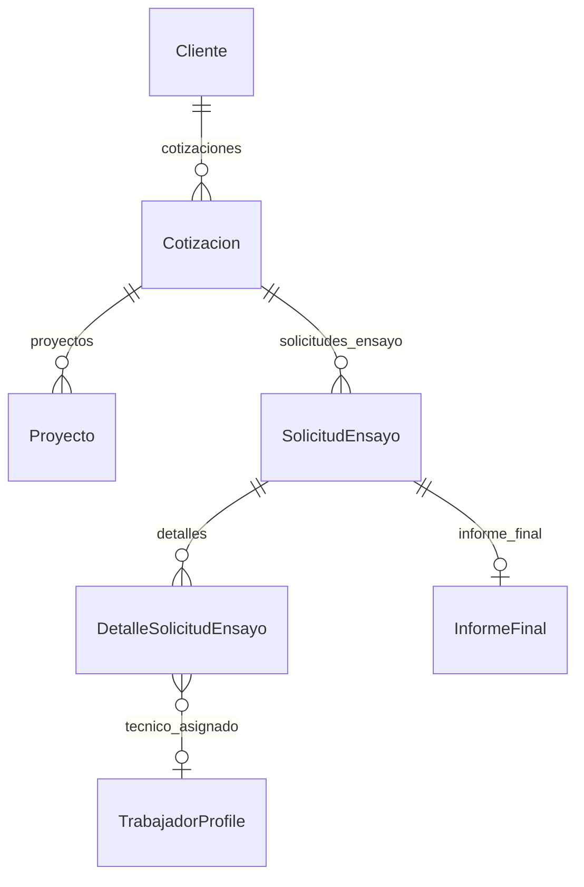

# VCF-LIMS — Design

| Dueño | Versión | Fecha | Estado |
|---|---|---|---|
| DLF | v1 | 2026-11-03 | Listo para implementar |

> Depende de `requirements.md` v1 (G1). Todo elemento de este diseño apunta a un REQ.

## 1. Modelo de datos

Sin cambios de esquema ni migraciones. Se usan los estados que ya existen en
`Cotizacion.ESTADO_CHOICES` (Enviada, Rechazada) y `Proyecto.ESTADOS_PROYECTO`.

## 2. Vistas y URLs

| URL | Vista | Permiso | REQ |
|---|---|---|---|
| `/dashboard/?periodo=mes\|6m\|12m\|rango&desde=&hasta=` | `core.views.dashboard_view` (delgada: lee el periodo y llama a `core.dashboard.construir_dashboard`) | `@login_required` | 01 a 21, 25 |
| `/servicios/cotizaciones/<pk>/enviada/` (POST) | `servicios.views.marcar_cotizacion_enviada` | `cotizaciones.ver` | 22, 24 |
| `/servicios/cotizaciones/<pk>/rechazada/` (POST) | `servicios.views.marcar_cotizacion_rechazada` | `cotizaciones.ver` | 23, 24 |

## 3. Componentes

| Componente | Tipo | Responsabilidad | REQ |
|---|---|---|---|
| `core/dashboard.py` | Módulo de funciones puras | `resolver_periodo(params, hoy)`, `periodo_anterior(periodo)` y un `construir_dashboard(periodo, user, hoy)` que devuelve un `dict` serializable. Solo agregaciones (`Count`, `Min`, `TruncMonth`), sin bucles por fila sobre la BD | 01-17, 21, 25 |
| `servicios.models.Cotizacion.TRANSICIONES_MANUALES` + `puede_marcarse_como(estado)` | Regla de dominio | RN-08 | 22-24 |
| `templates/dashboard.html` | Plantilla | Filtro, KPI, embudo, barras HTML, tablas `
`, `json_script` con los datos de los gráficos | 01-08, 10-20 |
| `static/vendor/chartjs/chart.umd.min.js` | Librería (Chart.js 4.4.1, MIT) | Barras apiladas y línea | 06, 09, 14, 19 |
| `static/js/dashboard.js` (`defer`) | Script | Lee `#dashboard-datos` y dibuja los dos gráficos de Chart.js con la paleta acordada | 06, 09, 14 |
| `servicios/templates/servicios/cotizacion_list.html` | Plantilla | Botones POST "Marcar como enviada" y "Marcar como rechazada" según RN-08 | 22-24 |

Paleta (validada con el validador de dataviz): azul `#2a78d6`; ordinal claro `#86b6ef` y oscuro `#104281`;
gris de perdidas `#c3c2b7`; cancelado `#a9a8a1`; alerta `#d03b3b` siempre con ícono y texto.

## 4. Reglas del CLAUDE.md que aplican

| Regla CLAUDE.md | Cómo aplica |
|---|---|
| Apps LIMS: NO renombrar, NO romper migraciones | Sin migraciones nuevas |
| 3. Campos prohibidos en respuestas públicas | El dashboard es interno (lab). La lista de vencidas muestra solo el código de la solicitud, nunca el cliente, así el técnico tampoco ve razones sociales |
| 7. Tareas de más de ~1 s a Celery | Todo es agregación SQL en la petición (REQ-LIMS-21, 26) |
| 17. Sin JS bloqueante en el `<head>` | Chart.js y `dashboard.js` con `defer`, servidos desde `static/` |

## 5. Riesgos

| # | Riesgo | Mitigación | Estado |
|---|---|---|---|
| R1 | Una migración nueva rompe datos ya aplicados en AWS | No hay migraciones | Cerrado |
| R2 | Las cifras de proyectos cambian al leer `Proyecto.estado` | Comparar con el dashboard anterior antes del pase (pregunta abierta 1) | Abierto |
| R3 | Las cotizaciones históricas nunca se marcaron como enviadas o rechazadas, así que la tasa saldrá "Sin datos" al principio | Esperado: se llena a medida que el equipo use los botones | Aceptado |

## 6. Historial

| Versión | Fecha | Autor | Cambio |
|---|---|---|---|
| v0 | 2026-10-12 | DLF | Plantilla inicial |
| v1 | 2026-11-03 | Claude (DLF) | Diseño del dashboard y de las transiciones de cotización |
