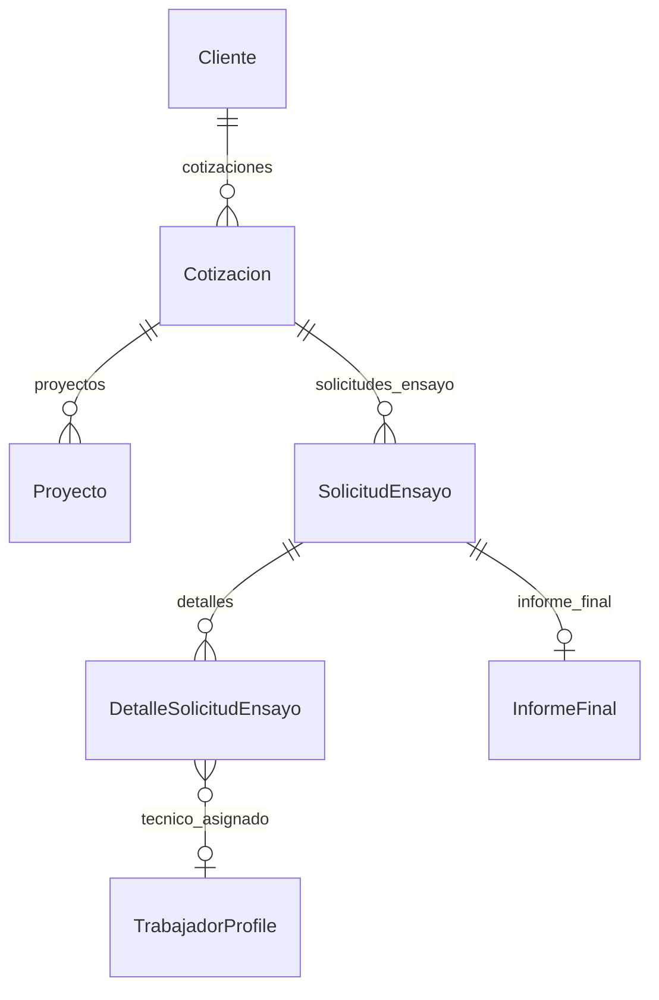

# VCF-LIMS — Design

| Dueño | Versión | Fecha | Estado |
|---|---|---|---|
| DLF | v2 | 2026-11-03 | Listo para implementar |

> Depende de `requirements.md` v1 (G1). Todo elemento de este diseño apunta a un REQ.

## 1. Modelo de datos

Sin cambios de esquema ni migraciones. Se usan los estados que ya existen en
`Cotizacion.ESTADO_CHOICES` (Enviada, Rechazada) y `Proyecto.ESTADOS_PROYECTO`.

## 2. Vistas y URLs

| URL | Vista | Permiso | REQ |
|---|---|---|---|
| `/dashboard/?periodo=mes\|6m\|12m\|rango&desde=&hasta=` | `core.views.dashboard_view` (delgada: lee el periodo y llama a `core.dashboard.construir_dashboard`) | `@login_required` | 01 a 21, 25 |
| `/servicios/cotizaciones/<pk>/enviada/` (POST) | `servicios.views.marcar_cotizacion_enviada` | `cotizaciones.ver` | 22, 24 |
| `/servicios/cotizaciones/<pk>/rechazada/` (POST) | `servicios.views.marcar_cotizacion_rechazada` | `cotizaciones.ver` | 23, 24 |

## 3. Componentes

| Componente | Tipo | Responsabilidad | REQ |
|---|---|---|---|
| `core/dashboard.py` | Módulo de funciones puras | `resolver_periodo(params, hoy)`, `periodo_anterior(periodo)` y un `construir_dashboard(periodo, user, hoy)` que devuelve un `dict` serializable. Solo agregaciones (`Count`, `Min`, `TruncMonth`), sin bucles por fila sobre la BD | 01-17, 21, 25 |
| `servicios.models.Cotizacion.TRANSICIONES_MANUALES` + `puede_marcarse_como(estado)` | Regla de dominio | RN-08 | 22-24 |
| `templates/dashboard.html` | Plantilla | Filtro, KPI, embudo, barras HTML, tablas `
`, `json_script` con los datos de los gráficos | 01-08, 10-20 |
| `static/vendor/chartjs/chart.umd.js` | Librería (Chart.js 4.4.1, MIT) | Barras apiladas y línea | 06, 09, 14, 19 |
| `static/js/dashboard.js` (`defer`) | Script | Lee `#dashboard-datos` y dibuja los dos gráficos de Chart.js con la paleta acordada | 06, 09, 14 |
| `servicios/templates/servicios/cotizacion_list.html` | Plantilla | Botones POST "Marcar como enviada" y "Marcar como rechazada" según RN-08 | 22-24 |

Paleta, validada con `validate_palette.js`:
- Barras por mes (categórica, 3 series): Aceptadas `#2a78d6`, En gestión `#1baf7a`, Rechazadas o anuladas `#eb6834`. Pasa todos los controles; el aqua queda bajo 3:1 contra el fondo, así que la leyenda y la tabla son obligatorias. El gris del mockup (`#c3c2b7`) se descartó porque no se distinguía del azul claro (ΔE 12 < 15).
- Solicitudes por estado (ordinal, un solo tono): `#86b6ef` → `#2a78d6` → `#104281`. Pasa como rampa ordinal.
- Embudo, línea y proyectos: una sola serie en `#2a78d6`; Cancelado en gris `#a9a8a1` (énfasis, con etiqueta).
- Alerta `#d03b3b`, siempre con ícono y texto.

## 4. Reglas del CLAUDE.md que aplican

| Regla CLAUDE.md | Cómo aplica |
|---|---|
| Apps LIMS: NO renombrar, NO romper migraciones | Sin migraciones nuevas |
| 3. Campos prohibidos en respuestas públicas | El dashboard es interno (lab). La lista de vencidas muestra solo el código de la solicitud, nunca el cliente, así el técnico tampoco ve razones sociales |
| 7. Tareas de más de ~1 s a Celery | Todo es agregación SQL en la petición (REQ-LIMS-21, 26) |
| 17. Sin JS bloqueante en el `<head>` | Chart.js y `dashboard.js` con `defer`, servidos desde `static/` |

## 5. Riesgos

| # | Riesgo | Mitigación | Estado |
|---|---|---|---|
| R1 | Una migración nueva rompe datos ya aplicados en AWS | No hay migraciones | Cerrado |
| R2 | Las cifras de proyectos cambian al leer `Proyecto.estado` | Comparar con el dashboard anterior antes del pase (pregunta abierta 1) | Abierto |
| R3 | Las cotizaciones históricas nunca se marcaron como enviadas o rechazadas, así que la tasa saldrá "Sin datos" al principio | Esperado: se llena a medida que el equipo use los botones | Aceptado |

## 5b. Análisis con tabla dinámica (v2, REQ-LIMS-27 a 40)

**Modelo:** app nueva `analisis` (capa LIMS). Un modelo, `VistaAnalisis`
(usuario, nombre, conjunto, `configuracion` JSON; única por usuario + conjunto +
nombre). Migración de datos `0002` que crea el permiso `reportes.ver` y lo da a
los roles cuyo nombre contiene "admin" o "gerent". No toca tablas existentes.

| URL | Vista | Permiso | REQ |
|---|---|---|---|
| `/analisis/?conjunto=&desde=&hasta=#c=<json>` | `analisis.views.analisis_view` | `reportes.ver` | 27, 34, 36 |
| `/analisis/datos/<conjunto>/?desde=&hasta=` (GET, JSON) | `datos_view` | `reportes.ver` + permiso del conjunto | 29-31, 38-40 |
| `/analisis/vistas/` (GET lista, POST JSON guarda) | `vistas_view` | `reportes.ver` | 35 |
| `/analisis/vistas/<pk>/eliminar/` (POST) | `eliminar_vista_view` | `reportes.ver` y dueño | 35 |

| Componente | Responsabilidad | REQ |
|---|---|---|
| `analisis/conjuntos.py` | Registro de conjuntos: permiso, fecha, lista blanca (`Campo`), vistas rápidas. `datos()` arma `encabezado` + `filas` copiando solo las claves de la lista blanca | 29, 31, 34, 38-40 |
| `templates/analisis/analisis.html` + `static/css/analisis.css` | Filtros, vistas, botones; estilo de PivotTable.js | 27, 30 |
| `static/js/analisis.js` (`defer`) | `pivotUI` con agregadores y renderizadores propios (tabla + 4 gráficos Chart.js), URL compartible, vistas guardadas, exportación SheetJS desde `pivotData` | 28, 32, 33, 35-37 |
| `static/vendor/{jquery 3.7.1, jquery-ui 1.13.2, pivottable 2.23.0, sheetjs 0.18.5}` | Librerías MIT/Apache-2.0, solo en esta página y sin `sourceMappingURL` (evita el fallo de `collectstatic` visto con Chart.js) | 28, 37 |

Paleta de los gráficos: categórica de 8 colores en orden fijo (`#2a78d6`, `#eb6834`,
`#1baf7a`, `#eda100`, `#e87ba4`, `#008300`, `#6250d6`, `#e34948`), validada en la
skill dataviz; "Otros" en gris `#8a8984`; 2 px de superficie entre segmentos apilados.

Riesgos: R4 `xlsx` 0.18.5 de npm tiene avisos de seguridad al **leer** archivos;
aquí solo se escribe, en el navegador. R5 El arrastrar de jQuery UI no funciona
con el dedo en celulares: en móvil se usan las vistas rápidas y guardadas.

## 6. Historial

| Versión | Fecha | Autor | Cambio |
|---|---|---|---|
| v0 | 2026-10-12 | DLF | Plantilla inicial |
| v1 | 2026-11-03 | Claude (DLF) | Diseño del dashboard y de las transiciones de cotización |
| v2 | 2026-11-03 | Claude (DLF) | Diseño de Análisis con tabla dinámica (app `analisis`) |
