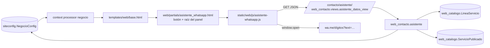
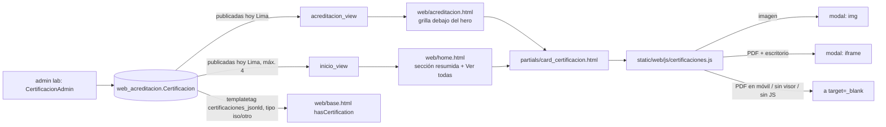
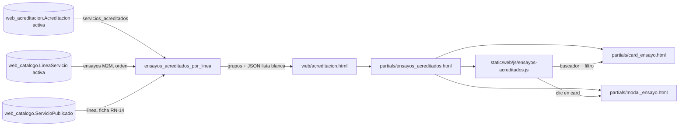
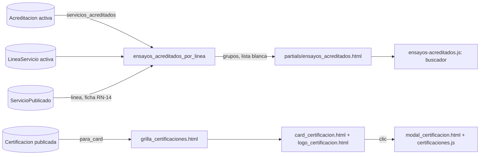

# VCF-WEB · Design · Asistente de WhatsApp y certificaciones

| Versión | Fecha | Estado |
|---|---|---|
| v6 | 2026-10-23 | Aprobado por el Gerente (modo rápido) · cambios de alcance v1.5 y v1.7, requerimiento nuevo v1.6 y cambios de diseño v1.8 y v1.9 del HU |

## Componentes



## Modelo de datos
`siteconfig.NegocioConfig`:
- Campos nuevos (migración `0008`): `horario_semana_receso_inicio` y `horario_semana_receso_fin` (TimeField, null), para el corte de mediodía de lunes a viernes. La migración `0009` carga 13:00 y 15:00 en la fila pk=1.
- `whatsapp_digitos` (propiedad): `whatsapp` reducido a dígitos, para `wa.me`.
- `horario_texto()`: texto humano del horario, por ejemplo "lunes a viernes de 8:00 a 13:00 y de 15:00 a 18:00, sábados de 8:00 a 13:00".
- `esta_abierto(momento)`: `True` si `momento` (convertido a America/Lima) cae dentro del horario. El domingo siempre está cerrado.

No se crean modelos nuevos. No se toca ningún modelo del LIMS (regla 1 de `CLAUDE.md`).

## Endpoint
`GET /contacto/asistente/` (`web_contacto:asistente_datos`), solo en `urls_web.py`. Responde JSON:

```json
{
  "saludo": "Buenas tardes",
  "abierto": true,
  "horario": "lunes a viernes de 8:00 a 13:00 y de 15:00 a 18:00, sábados de 8:00 a 13:00",
  "whatsapp": "51964326364",
  "lineas": [
    {"nombre": "…", "resumen": "…", "url": "/servicios/<slug>/",
     "slug": "<slug>",
     "ensayos": [{"titulo": "…", "resumen": "…", "slug": "<slug>", "url": "/servicios/<slug>/" | null}]}
  ]
}
```
- *(v2)* `slug` es la clave estable con la que el JS guarda el paso en `sessionStorage` (ya es público: forma parte de la URL). `url` es `null` cuando la página no está publicada (REQ-WEB-21): un ensayo cuyo slug coincide con el de una línea activa nunca llega a su página, porque `servicio_detalle_view` resuelve primero `LineaServicio`. Las líneas listadas siempre son activas, así que su `url` existe.
- Lista blanca con `.values()` y `.only()`: no salen precio, código, acreditado ni `servicio_id` (regla 2 de `CLAUDE.md`).
- El catálogo se cachea 5 minutos (`asistente:catalogo:v2`; en v2 cambió la clave porque cambió el formato). El saludo y `abierto` se calculan en cada request con `timezone.localtime()` (`TIME_ZONE = 'America/Lima'`), y la respuesta lleva `Cache-Control: no-store`.
- Solo GET (`require_GET`). Si no hay `NegocioConfig` o falta el WhatsApp, responde 404.

## Plantillas
- `templates/web/partials/asistente_whatsapp.html`: `<a>` flotante a `wa.me/<dígitos>` (funciona sin JS), raíz `#asistente-wa` con `role="dialog"` y `data-endpoint`, y el `<script defer>` del JS. Va dentro de ``.
- `templates/web/base.html`: incluye el partial una vez para todas las páginas.
- `templates/web/home.html`: se quita el botón flotante propio (pasa al partial) y el horario muestra el receso.
- `templates/web/contacto.html`: usa `negocio.whatsapp_digitos` en lugar de la cadena de `cut`.

## JavaScript (`static/web/js/asistente-whatsapp.js`)
- Máquina de pasos sin dependencias. Los textos T-01 a T-40 van como constantes (sección 7 del HU, aprobados en G1).
- Funciones puras exportadas en `window.VicafAsistente` y en `module.exports` para testearlas con `node --test`: `armarMensajeCotizacion`, `armarMensajeServicio`, `armarMensajeAsesor`, `urlWhatsapp`, `validarCantidad`, `ubicacionExcluida`.
- Estado: `respuestas = {nombre, empresa, servicio, cantidad, ubicacion}`, en un solo objeto, listo para la opción C.
- Accesibilidad: el panel tiene `aria-modal="false"` y el foco va al primer control; Esc cierra; los botones son `<button>` reales.
- Estilos: clases Tailwind ya presentes en el proyecto. `tailwind.config.js` ya escanea `static/web/js/**/*.js`.

## v2 · Navegación con el panel abierto (REQ-WEB-20 a 29)

### Estado en el navegador
Clave `sessionStorage['vicaf:asistente-wa']`, JSON versionado:

```json
{"v": 1, "abierto": true,
 "pila": [{"p": "menu"}, {"p": "lineas"}, {"p": "linea", "linea": "mecanica-de-suelos"},
          {"p": "ensayo", "linea": "mecanica-de-suelos", "ensayo": "ensayo-cbr"}],
 "respuestas": {"nombre": "…", "empresa": "", "servicio": "Ensayo CBR", "servicioPreelegido": true,
                "cantidad": "", "ubicacion": ""}}
```

- La pila de pasos deja de ser una pila de funciones (v1) y pasa a ser una lista de objetos `{p, …params}` serializables. Un registro `PASOS[p]` pinta cada uno. Pasos: `menu`, `lineas`, `linea`, `ensayo`, `asesor`, `fuera` (aviso T-40, guarda el mensaje y si viene de la cotización), `nombre`, `empresa`, `servicio`, `servicioOtro`, `cantidad`, `ubicacion`, `resumen`, `enviado`.
- Se guarda en cada cambio de paso, al abrir, al cerrar y al validar una respuesta. Lo que el visitante escribió y aún no envió en un campo no se guarda.
- Funciones puras nuevas, probadas con `node --test`: `estadoInicial`, `serializarEstado`, `leerEstado` (descarta JSON roto, versiones distintas y pasos desconocidos), `podarPila` (REQ-WEB-24: corta la pila en el primer paso cuya línea o ensayo ya no existe y garantiza `menu` en la base) y `enlaceWeb` (solo acepta rutas relativas `/servicios/<slug>/`; `null` en otro caso).
- Acceso a `sessionStorage` siempre en `try/catch` (REQ-WEB-29).

### Ciclo de vida
1. `DOMContentLoaded`: lee el estado. Si `abierto`, abre el panel sin mover el foco (REQ-WEB-22), pide el endpoint y pinta el último paso de la pila podada.
2. Botón flotante: abre y pinta el último paso, o el menú si no hay estado (REQ-WEB-04). El foco va al primer control, como en v1.
3. `×` o Esc: `abierto = false`, se guarda y se devuelve el foco al botón (REQ-WEB-27). La pila se conserva para retomar.
4. "Ver en la web" es un `<a href>` normal, sin `target`, en la misma pestaña. Como el estado ya está guardado, la página siguiente lo restaura.
5. "Menú principal" (`[data-asistente-menu]`, en la cabecera) se oculta en el paso `menu` y en los demás lleva a `menu` vaciando la pila (REQ-WEB-25).

### Móvil (REQ-WEB-28)
- El contenedor mantiene la posición de v1 (`fixed bottom-5 right-5`) y en `< sm` pasa a `max-sm:inset-x-4 max-sm:bottom-4` (16 px de margen), con `max-sm:pointer-events-none` y sus hijos `max-sm:pointer-events-auto`, para que la franja vacía no tape toques sobre la página.
- *(T11)* Todo lo nuevo de v2 va en variantes `max-sm:` sobre las clases base de v1. Si el navegador conserva un `output.css` anterior (el `runserver` de dev no manda `Cache-Control`), el botón sigue visible y clicable en su esquina; antes quedaba `fixed` sin `bottom`/`right`, debajo del footer.
- El área de mensajes: `max-h-[min(28rem,70vh)]` (v1) y `max-sm:max-h-[40vh]` en móvil. `overscroll-contain`, para que el scroll del panel no arrastre a la página.
- Con el panel abierto en móvil, el contenedor lleva `data-abierto="true"` y el botón flotante se oculta (`max-sm:group-data-[abierto=true]:hidden`). La cabecera ya tiene ×.
- `body.style.paddingBottom` = alto del panel + 16 px mientras está abierto en `< 640 px` (`matchMedia`, recalculado con `ResizeObserver`). Así el final de cualquier página se puede leer por encima del panel. Se restaura al cerrar.
- No hay capa ni `aria-modal`: la página sigue siendo usable con el panel abierto.

### Reglas de `CLAUDE.md` que aplican
- 2 y 3 (lista blanca): el payload solo suma `slug`, que ya es público. Sigue sin salir precio, código, acreditado ni `servicio_id`.
- 15 (`noindex`): no cambia, el asistente no crea URLs nuevas.
- 17 (rendimiento): JS `defer`, sin dependencias nuevas, sin peticiones extra salvo el endpoint cuando el panel se restaura abierto.

## Riesgos
| Riesgo | Mitigación |
|---|---|
| Caché de 5 min: un cambio en el admin tarda en verse en el asistente | Aceptable; se documenta |
| *(v2)* El paso guardado apunta a algo despublicado | `podarPila` cae al paso válido más cercano (REQ-WEB-24) |
| *(v2)* Datos del visitante (nombre, empresa) en `sessionStorage` | Solo en su navegador y en esa pestaña; se borran al cerrarla; nunca van al servidor (RN-12) |
| *(v2)* En móvil el panel ocupa la mitad inferior | Altura limitada, sin capa, y `padding-bottom` en `body` para leer todo el contenido; × siempre visible |
| Ventanas emergentes bloqueadas en `window.open` | Se usa un `<a target="_blank">` real en el último paso, así que el clic es del usuario |
| Validación de ubicación con texto libre (P-03) | Lista de D-VCF-002 y sufijo ", Cajamarca" |
| El CSS se compila con Tailwind (`output.css` está en `.gitignore`) | Correr `npm run build:css` o el contenedor `node` |

## v3 · Certificado ISO 9001 (REQ-WEB-30 a 38)

> **Reemplazado por v4** (al final). Se conserva como historia; de aquí siguen vigentes las cabeceras (REQ-WEB-37) y el criterio de escritorio del visor.

```mermaid
flowchart LR
  ADM[admin lab: CertificacionAdmin] --> M[(web_acreditacion.Certificacion)]
  M -->|publicadas hoy Lima| V[acreditacion_view]
  V --> T[web/acreditacion.html<br>tarjeta + partial modal_certificado_pdf.html]
  T --> JS[static/web/js/certificado-pdf.js]
  JS -->|escritorio| MOD[modal con iframe del PDF]
  JS -->|móvil / sin visor / sin JS| TAB[a target=_blank: pestaña nueva]
  M -->|templatetag certificaciones_jsonld| BASE[web/base.html LocalBusiness.hasCertification]
  PDF[/media/certificaciones/*.pdf] -->|X-Frame-Options SAMEORIGIN| MOD
```

### Modelo de datos
`web_acreditacion.Certificacion` (modelo nuevo; `Acreditacion` no cambia, porque una certificación de sistema de gestión no tiene ensayos acreditados y sí tiene norma y sede). No toca ningún modelo del LIMS (regla 1). Sin `SeoModel`: no tiene página propia, se lista dentro de `/acreditacion/` (mismo criterio que `Acreditacion`).

| Campo | Tipo | Notas |
|---|---|---|
| `norma` | `CharField(60)` | "ISO 9001:2015" |
| `sistema` | `CharField(120)`, blank | "Sistema de Gestión de la Calidad" |
| `numero_certificado` | `CharField(50)`, único | "ER-0146/2026" |
| `organismo` | `CharField(150)` | "AENOR CONFIA S.A.U." |
| `alcance` | `TextField` | Texto de "para las actividades" |
| `sede` | `CharField(200)`, blank | "que se realizan en" |
| `fecha_emision` | `DateField`, null | Primera emisión |
| `vigencia_hasta` | `DateField` | Obligatoria: sin ella no hay RN-15 |
| `archivo` | `FileField(upload_to='certificaciones/')`, blank | Validadores: extensión `pdf`, firma `%PDF-`, ≤ 10 MB |
| `sello` | `ImageField(upload_to='certificaciones/sellos/')`, blank | |
| `sello_alt` | `CharField(125)`, blank | Obligatorio si hay sello (`clean()`, igual que `Acreditacion.logo_alt`) |
| `orden`, `activo`, `creado`, `actualizado` | | Igual que `Acreditacion` |

- `CertificacionQuerySet.publicadas(hoy=None)`: `activo=True`, `vigencia_hasta >= hoy` y `archivo` no vacío; `hoy` = `timezone.localdate()` (`TIME_ZONE = 'America/Lima'`). Es la única puerta: la usan la vista y el templatetag del JSON-LD (RN-15, REQ-WEB-31).
- Migración `0002_certificacion` (esquema) y `0003_seed_certificado_iso9001` (datos leídos del PDF, sin archivo ni sello: la tarjeta no aparece hasta que el administrador sube el PDF). `update_or_create` no: `get_or_create` por `numero_certificado`, así que no pisa lo que el administrador ya haya corregido.

### Vista y plantilla
- `acreditacion_view` agrega `certificaciones = Certificacion.objects.publicadas().only(...)` con lista blanca de campos (regla 2).
- `templates/web/acreditacion.html`: sección nueva después de las acreditaciones, con H2 "Certificación de calidad" (el único H1 sigue siendo el de INACAL; regla 9). La meta y la keyword de la URL no cambian (regla 10).
- Tarjeta (`web/partials/tarjeta_certificacion.html`): sello con `width`/`height` y `loading="lazy"` (regla 17) o distintivo de texto; datos en `<dl>`. El botón es `<a href="{{ archivo.url }}" target="_blank" rel="noopener" data-cert-pdf-open data-cert-pdf-titulo="…">`: sin JS ya abre la pestaña nueva (REQ-WEB-35).
- `web/partials/modal_certificado_pdf.html`: un solo modal para todas las certificaciones; `role="dialog"`, `aria-modal="true"`, `aria-labelledby`; `<iframe title="…">` sin `src` hasta abrir; "Descargar" es `<a download>` y "Cerrar" un `<button>`. Solo se incluye si hay certificaciones publicadas.

### JavaScript (`static/web/js/certificado-pdf.js`)
- Funciones puras exportadas en `module.exports` (pruebas con `node --test`): `debeUsarModal(navigator, matchMedia)` → `true` solo si `pdfViewerEnabled !== false` y `matchMedia('(min-width: 768px) and (hover: hover) and (pointer: fine)').matches`; `siguienteFoco(total, indiceActual, haciaAtras)` → índice del siguiente control al ciclar con Tab.
- Clic en `[data-cert-pdf-open]`: si `debeUsarModal`, `preventDefault`, pone `src` del iframe y `href` de "Descargar", título, `body.style.overflow = 'hidden'`, foco en ×. Si no, no hace nada y el enlace abre la pestaña nueva (REQ-WEB-35).
- Cierre (Esc, clic en el fondo, ×, "Cerrar"): oculta, `iframe.src = 'about:blank'` (libera el PDF), restaura el scroll y el foco (REQ-WEB-33).
- Trampa de foco: `keydown` Tab dentro del modal usa `siguienteFoco` sobre `a[href], button, iframe` visibles (REQ-WEB-34). Límite conocido: con el foco dentro del visor de PDF, las teclas las recibe el visor del navegador, no la página; para salir del visor se usa Tab/Shift+Tab o el clic.
- No se toca `modal-certificado.js` (modal de la imagen INACAL).

### Cabeceras (REQ-WEB-37)
- Dev (`grupovicaf/urls_web.py`): antes del `static()` genérico, `media/certificaciones/<path>` se sirve con `web_acreditacion.views.servir_certificado_dev`, envuelta en `xframe_options_sameorigin`. Solo con `DEBUG`.
- Prod (`deploy/nginx/grupovicaf.conf`, server `www`): `location /media/certificaciones/` con sus propios `add_header` (nginx no hereda los del `server` si la `location` define alguno): `X-Frame-Options SAMEORIGIN`, `X-Content-Type-Options nosniff`, `Referrer-Policy`. El resto de `www` sigue en `DENY`. `laboratorio` no cambia.

### JSON-LD (REQ-WEB-38)
- Templatetag `` (`web_acreditacion/templatetags/certificaciones.py`): arma la lista en Python con `json.dumps` y escapa `<`, `>` y `&` (como `json_script`), así que no depende de `escapejs`. Una consulta por página, con `.only()`.
- `web/base.html`: dentro de `LocalBusiness`, `"hasCertification": [...]` solo si hay alguna publicada. Cada elemento: `{"@type": "Certification", "name": "ISO 9001:2015 · Sistema de Gestión de la Calidad", "certificationIdentification": "ER-0146/2026", "issuedBy": {"@type": "Organization", "name": "AENOR CONFIA S.A.U."}, "validFrom": "2026-04-01", "expires": "2029-04-01", "certificationStatus": "https://schema.org/CertificationActive", "url": "<SITE_URL>/media/certificaciones/…pdf"}`.

### Reglas de `CLAUDE.md` que aplican
- 1 (no duplicar LIMS), 2 (lista blanca con `.only()`), 4 (el admin solo en `urls_lab.py`), 9 y 10 (un H1, misma keyword), 12 (canonical sin cambios), 13 (JSON-LD), 17 (imágenes con tamaño y lazy, JS `defer`, PDF cargado solo al abrir el modal).

### Riesgos (v3)
| Riesgo | Mitigación |
|---|---|
| nginx del servidor sin actualizar: el modal queda en blanco por `DENY` | Paso explícito en el despliegue (T15); el enlace sigue funcionando en móvil y como pestaña nueva |
| Navegador de escritorio que bloquea PDF embebidos (plugin desactivado) | `pdfViewerEnabled === false` → pestaña nueva; si aun así falla, "Descargar" queda a mano en el modal |
| Datos leídos de una imagen | Se corrigen desde el admin (P-12, P-13) |
| El PDF vencido sigue accesible por URL directa | Fuera de alcance; el administrador puede borrar el archivo |

## v4 · Modelo único de certificaciones (REQ-WEB-39 a 52)



### Modelo de datos
`web_acreditacion.Certificacion` se reescribe (sigue sin `SeoModel`: no tiene página propia). `Acreditacion` no cambia (P-16).

| Campo | Tipo | Notas |
|---|---|---|
| `titulo` | `CharField(120)` | "Acreditación INACAL LE-230" |
| `descripcion` | `CharField(200)` | Descripción corta; la card la recorta a 3 líneas |
| `tipo` | `CharField(20, choices)` | `acreditacion` / `iso` / `otro`; índice compuesto no hace falta (pocas filas) |
| `institucion` | `CharField(150)` | "Institución que la otorga" |
| `archivo` | `FileField(upload_to='certificaciones/')` | Obligatorio en el admin. Validadores: extensión `pdf/jpg/jpeg/png/webp`, `validar_archivo` (≤ 10 MB; `.pdf` con firma `%PDF-`; imagen que Pillow pueda `verify()`) |
| `vigencia_hasta` | `DateField`, null | Opcional: sin fecha no vence |
| `orden`, `activo`, `creado`, `actualizado` | | Igual que v3 |

- `es_pdf` (propiedad): por la extensión del archivo guardado. La card la pasa al JS como `data-cert-tipo="pdf|imagen"`.
- `CertificacionQuerySet.publicadas(hoy=None)`: `activo`, archivo no vacío y (`vigencia_hasta` nula o ≥ hoy de Lima). Es la única puerta (vista de acreditación, vista de inicio, JSON-LD).
- Migraciones (aditivas, porque `0002`/`0003` ya están aplicadas en bases de prueba):
  - `0004`: agrega `titulo`, `descripcion`, `tipo`, `institucion`; `vigencia_hasta` pasa a null; validadores nuevos de `archivo`.
  - `0005` (`RunPython`): cada fila de v3 → `titulo = "Certificación <norma>"`, `descripcion` con sistema y N.º, `tipo = iso` si la norma empieza con "ISO", `institucion = organismo`. Crea INACAL LE-230 (`get_or_create` por tipo y título): copia `static/web/img/certificaciones/GRUPO-VICAF-CERTIFICADO.webp` a `certificaciones/inacal-le-230.webp` en el storage si aún no existe, vigencia 2027-05-27, orden 0 (ISO queda en 1). Reversa: borra la fila INACAL creada (el archivo se deja).
  - `0006`: quita `norma`, `sistema`, `numero_certificado`, `organismo`, `alcance`, `sede`, `fecha_emision`, `sello`, `sello_alt`.

### Vistas
- `acreditacion_view` e `inicio_view` usan `publicadas().only('id', 'titulo', 'descripcion', 'tipo', 'institucion', 'archivo', 'vigencia_hasta')` (regla 2). La home corta a `[:4]`.
- Ambas pasan `certificacion_acreditacion` = la primera publicada de tipo `acreditacion` (REQ-WEB-50), para los accesos INACAL.

### Plantillas
- `partials/card_certificacion.html`: `<article class="relative flex h-full flex-col …">` con etiqueta de tipo, `<h3>` cuyo `<a>` lleva `after:absolute after:inset-0` (enlace estirado: toda la card es clicable con un solo enlace accesible), descripción con `line-clamp-3` e institución al pie (`mt-auto`). `focus-within:ring` para el foco visible.
- `partials/enlace_certificacion.html`: atributos del enlace (`href`, `target`, `rel`, `data-cert-open`, `data-cert-tipo`, `data-cert-titulo`), compartidos por la card y los accesos INACAL.
- `partials/grilla_certificaciones.html`: `<ul class="grid grid-cols-1 gap-6 sm:grid-cols-2 lg:grid-cols-4">`, usada en las dos páginas.
- `partials/modal_certificacion.html`: un solo modal por página (reemplaza `modal_certificado_pdf.html` y `modal_certificado_inacal.html`), con `` y `<iframe data-cert-visor>` sin `src` hasta abrir, "Descargar" (`<a download>`) y "Cerrar".
- `/acreditacion/`: hero → grilla (H2 "Acreditaciones y certificaciones") → sección de `Acreditacion` (alcance y ensayos) sin cambios. *(v5: la sección pasa a cards, ver abajo.)*
- Home: la sección oscura de acreditación pierde la imagen grande; queda el texto y debajo la grilla (máx. 4) con "Ver todas".

### JavaScript (`static/web/js/certificaciones.js`)
Reemplaza `certificado-pdf.js` y `modal-certificado.js`. Funciones puras en `module.exports`:
- `modoApertura(tipo, navigator, matchMedia)` → `'imagen'` (siempre modal), `'pdf'` (modal con iframe si `debeUsarModal`) o `'pestana'` (no intercepta el clic).
- `debeUsarModal` y `siguienteFoco` sin cambios desde T14.
- Abrir: título, `src` del `img` o del `iframe` (el otro queda oculto), `href` de "Descargar", `overflow: hidden` en `body`, foco en ×. Cerrar: oculta, vacía `src` (`about:blank` en el iframe, se quita en la imagen), restaura scroll y foco.

### JSON-LD (REQ-WEB-51)
`certificaciones_jsonld` filtra `publicadas().exclude(tipo='acreditacion')`; cada item: `{"@type": "Certification", "name": titulo, "description": descripcion, "issuedBy": {"@type": "Organization", "name": institucion}, "certificationStatus": "https://schema.org/CertificationActive", "url": SITE_URL + archivo.url}` y `expires` si hay vigencia.

### Reglas de `CLAUDE.md` que aplican
- 1 y 2 (sin modelos del LIMS, `.only()`), 9 (un H1 por página: los títulos de las cards son H3), 10 (la keyword de `/acreditacion/` sigue siendo "laboratorio acreditado INACAL", ahora con Cajamarca), 13 (JSON-LD), 17 (sin imágenes en las cards; el archivo se carga solo al abrir; JS `defer`).

### Riesgos (v4)
| Riesgo | Mitigación |
|---|---|
| La migración `0005` escribe en `/media/` (copia la imagen de INACAL) | Solo si el archivo no existe; si falta la imagen estática, la fila se crea sin archivo y no se publica |
| Se pierden en la BD el N.º, el alcance, la sede y el sello del ISO 9001 | Quedan en el PDF y en la descripción corta; era el pedido del Gerente (campos explícitos) |
| nginx sin actualizar | Igual que T15: el modal de PDF queda en blanco; las imágenes no dependen de `X-Frame-Options` |

## v5 · Todo en cards: ensayos acreditados (REQ-WEB-53 a 61)



### Vista (`web_acreditacion/views.py`)
- `ensayos_acreditados_por_linea(acreditaciones)` recibe las `Acreditacion` activas con `servicios_acreditados` precargados y devuelve `(grupos, detalle)`:
  - `grupos`: `[{'clave', 'nombre', 'ensayos': [{'id', 'nombre', 'norma', 'linea', 'url', 'buscar'}]}]`, en el orden de las líneas y con "Otros ensayos acreditados" (`clave = 'otros'`) al final (REQ-WEB-54). `clave` es el slug de la línea.
  - `detalle`: `{id: {'nombre', 'linea', 'norma', 'norma_nombre', 'metodo', 'acreditacion', 'resumen', 'url'}}`, que la plantilla pasa por `json_script` al modal. `acreditacion` = "INACAL · N.º LE-230" (todas las acreditaciones del ensayo, separadas por "; "); `norma_nombre` vacío si es igual al código.
- Consultas: `Servicio.objects.select_related('norma', 'metodo', 'publicado').only(...)` con solo `nombre`, `norma__codigo`, `norma__nombre`, `metodo__nombre` y de `publicado` `slug`, `activo`, `titulo_publico`, `resumen`, `linea_id`, más `Prefetch('lineas_servicio', LineaServicio.objects.publicadas().only('id'))`. Las líneas activas se leen una vez (8 filas) para nombre, slug y orden. Nunca `precio_base`, `unidad_base`, `codigo_facturacion` ni `esta_acreditado` (REQ-WEB-60).
- `url` de la ficha: `/servicios/<slug>/` solo si `publicado.activo` y su slug no es el de una línea activa (RN-14, igual que el asistente); si no, `None`.
- `acreditacion_view` pasa `grupos_ensayos`, `ensayos_detalle` y `total_ensayos`.

### Plantillas
- `partials/ensayos_acreditados.html`: H2 "Ensayos acreditados" y, por cada `Acreditacion`, institución, N.º en `mono-tag`, vigencia y alcance (texto, no lista), con el enlace al PDF si lo tiene. Debajo, la barra de búsqueda (`<div data-ensayos-controles hidden>`: `<input type="search">` con `<label>`, botones de línea con `aria-pressed`, contador `aria-live="polite"`), el aviso sin resultados con "Limpiar búsqueda" (oculto) y un `<section data-ensayos-grupo="<clave>">` por grupo con H3, número de ensayos y `<ul class="grid grid-cols-1 gap-6 sm:grid-cols-2 lg:grid-cols-4">`. Al final, `{{ ensayos_detalle|json_script:"ensayos-acreditados-datos" }}` y el modal.
- `partials/card_ensayo.html`: mismo esqueleto que `card_certificacion.html` (`card-tech`, `h-full`, control estirado `after:absolute after:inset-0`, `focus-within:ring`): norma en `mono-tag` arriba, nombre en H4 con `line-clamp-3`, línea al pie. El control es `<a href="/servicios/<slug>/">` si hay ficha y `<button type="button">` si no; los dos con `data-ensayo-open="<id>"`. El `<li>` lleva `data-ensayo-linea` y `data-ensayo-buscar` (texto para el buscador).
- `partials/modal_ensayo.html`: `#modal-ensayo`, mismo marco que `modal_certificacion.html`; cuerpo con `<dl>` (Línea, Norma, Método, Acreditación) y el resumen; pie con "Ver ficha del ensayo" (oculto sin ficha), "Solicitar cotización" y "Cerrar".

### JavaScript (`static/web/js/ensayos-acreditados.js`)
Funciones puras en `module.exports`, probadas con `node --test`:
- `normalizar(texto)`: minúsculas, sin tildes (`NFD` y quitar `\u0300-\u036f`), espacios colapsados.
- `coincide(textoBuscable, consulta)`: todas las palabras de la consulta están en el texto normalizado; consulta vacía coincide siempre.
- `visible(item, consulta, linea)`: `coincide` y (`linea` vacía o igual a la del item).
- `textoResultados(n, total)`: "Se muestran los 99 ensayos acreditados." / "1 ensayo acreditado coincide." / "12 ensayos acreditados coinciden." / "Ningún ensayo acreditado coincide.".
- `siguienteFoco`: misma lógica que `certificaciones.js` (copiada: la página puede no cargar ese archivo si no hay certificaciones publicadas).
Comportamiento: quita `hidden` de los controles; en `input` filtra (sin debounce: ~100 nodos), oculta grupos vacíos, actualiza el número de ensayos de cada línea, el contador y el aviso. Clic en `[data-ensayo-open]`: `preventDefault` (también en los enlaces a la ficha) y abre el modal con los datos del JSON. Sin JS, los enlaces llevan a la ficha (REQ-WEB-61).

### Reglas de `CLAUDE.md` que aplican
- 1 a 3: sin modelos nuevos; lista blanca en la vista y en el JSON. 9: H1 único (hero); H2 de sección, H3 por línea, H4 por card. 17: sin imágenes en las cards; JS `defer`. Sin migraciones.

### Riesgos (v5)
| Riesgo | Mitigación |
|---|---|
| Líneas sin ensayos vinculados (dev, PM-12): todo cae en "Otros ensayos acreditados" | Se muestra igual; en producción, revisar `LineaServicio.ensayos` tras `revincular_catalogo` |
| ~100 cards en una página | Sin imágenes; filtro en el cliente; el H3 por línea y el filtro reducen el recorrido |
| Un ensayo en varias líneas solo aparece en la primera | Documentado (P-19); el buscador lo encuentra igual |

## v6 · Rediseño de certificaciones y lista de ensayos (REQ-WEB-62 a 70)

Reemplaza las cards de v4 y la sección de ensayos de v5. `card_ensayo.html` y `modal_ensayo.html` se borran.

### Modelo de datos (migración `web_acreditacion/0007_certificacion_logo`)
- `Certificacion.logo = ImageField(upload_to='certificaciones/logos/', blank=True, width_field='logo_ancho', height_field='logo_alto')`, validadores `FileExtensionValidator(jpg, jpeg, png, webp)` y `validar_logo` (≤ 2 MB).
- `logo_ancho` y `logo_alto`: `PositiveIntegerField(null=True, editable=False)`; Django los llena al subir el logo y la plantilla los usa como `width`/`height` sin abrir el archivo (regla 17).
- `para_card()` agrega `logo`, `logo_ancho` y `logo_alto` a la lista blanca. Admin: `logo` y `vista_previa_logo` en el fieldset "Card".
- Sin migración de datos: los logos se suben desde el admin.

### Plantillas
- `partials/logo_certificacion.html` (nuevo): franja superior (`h-40`, o `h-28` en la home) con degradado blanco → `slate-50`; `` con `max-h-[62%] max-w-[78%] object-contain` y `group-hover:scale-105`; sin logo, el ícono "check-badge" en un círculo `blue-50`.
- `partials/card_certificacion.html`: `card-tech` (sombra `layered`, borde `slate-200`, hover `-translate-y-1` y `shadow-layered-lg`) + `overflow-hidden`; franja del logo, cuerpo (tipo en versalitas de color por tipo, H3 con el enlace estirado, descripción `line-clamp-3`) y pie "Ver documento" (`aria-hidden`, el enlace ya lleva el nombre accesible). Con `compacta` (home) no muestra tipo ni descripción.
- `partials/grilla_certificaciones.html`: `<ul class="flex flex-wrap justify-center gap-6">` con `<li>` de `w-full`, `sm:w-[calc((100%-1.5rem)/2)]` y `lg:w-[calc((100%-4.5rem)/4)]`. Flex en vez de grid para centrar las filas incompletas; los `<li>` se estiran a la altura de la fila y la card es `h-full`.
- `partials/modal_certificacion.html`: agrega `[data-cert-alterno]` (oculto con la clase `hidden`) con el aviso y `<a data-cert-abrir target="_blank">Abrir documento</a>`.
- `home.html`: ``.
- `partials/ensayos_acreditados.html`: alcance de cada acreditación (igual que v5); buscador con ícono y contador `aria-live` en `<div data-ensayos-controles hidden>`; aviso sin resultados; un `<details data-ensayos-grupo="<clave>" open class="card-flat">` por grupo con `<summary>` (H3, contador en pastilla `blue-50`, chevron que gira con `group-open/linea`) y `<ul class="columns-1 md:columns-2 lg:columns-3">` de `<li class="break-inside-avoid" data-ensayo-buscar>` con el check `emerald-600`, el nombre (enlace si hay ficha) y la norma en `mono-tag`. El `<li>` no lleva clase de display para que el atributo `hidden` funcione.

### Vista
- `ensayos_acreditados_por_linea()` devuelve solo `grupos` (`[{'clave', 'nombre', 'ensayos': [{'nombre', 'norma', 'url', 'buscar'}]}]`); ya no arma el JSON del modal. Orden dentro del grupo con `_orden_alfabetico()` (NFD sin marcas + `casefold`). La consulta deja de leer `norma__nombre` y `publicado__resumen`. `total_ensayos` se suma de los grupos.



### JavaScript
- `certificaciones.js`: `modoApertura()` devuelve `'imagen'`, `'pdf'` o `'enlace'` (antes `'pestana'`); siempre hace `preventDefault` y abre el modal. En `'enlace'` oculta `[data-cert-contenido]`, muestra `[data-cert-alterno]` y apunta "Abrir documento" y "Descargar" al archivo; al usar "Abrir documento" el modal se cierra.
- `ensayos-acreditados.js`: quedan `normalizar`, `coincide`, `textoResultados` y `textoCuenta` (nuevo); se quitan `visible`, `siguienteFoco` y el modal. En `input` oculta ensayos y grupos sin resultados, abre (`open = true`) los grupos con resultados mientras haya consulta y actualiza contadores; sin consulta respeta lo que el visitante plegó.

### Reglas de `CLAUDE.md` que aplican
- 1 a 3: sin modelos nuevos del LIMS; lista blanca (`para_card()`, grupos sin precio ni código). 9: H1 único; H2 de sección; H3 en cards y en cada línea. 17: logos con `width`/`height` y `loading="lazy"`; JS `defer`. Migración revisada: solo `AddField`.

### Riesgos (v6)
| Riesgo | Mitigación |
|---|---|
| Logos con mucho margen transparente se ven chicos | Recortar antes de subir (en dev se recortó el de INACAL); la ayuda del campo lo pide |
| En móvil el modal de un PDF no muestra el documento | Aviso con "Abrir documento" y "Descargar" (P-20) |
| 97 de 99 ensayos en "Otros" en dev (PM-12) | Igual que v5: en producción revisar `LineaServicio.ensayos` |
