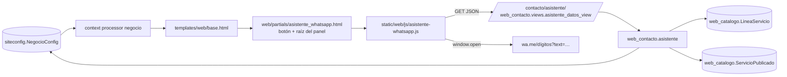

# VCF-WEB · Design · Asistente de WhatsApp

| Versión | Fecha | Estado |
|---|---|---|
| v1 | 2026-10-15 | Aprobado por el Gerente (modo rápido) |

## Componentes



## Modelo de datos
`siteconfig.NegocioConfig`:
- Campos nuevos (migración `0008`): `horario_semana_receso_inicio` y `horario_semana_receso_fin` (TimeField, null), para el corte de mediodía de lunes a viernes. La migración `0009` carga 13:00 y 15:00 en la fila pk=1.
- `whatsapp_digitos` (propiedad): `whatsapp` reducido a dígitos, para `wa.me`.
- `horario_texto()`: texto humano del horario, por ejemplo "lunes a viernes de 8:00 a 13:00 y de 15:00 a 18:00, sábados de 8:00 a 13:00".
- `esta_abierto(momento)`: `True` si `momento` (convertido a America/Lima) cae dentro del horario. El domingo siempre está cerrado.

No se crean modelos nuevos. No se toca ningún modelo del LIMS (regla 1 de `CLAUDE.md`).

## Endpoint
`GET /contacto/asistente/` (`web_contacto:asistente_datos`), solo en `urls_web.py`. Responde JSON:

```json
{
  "saludo": "Buenas tardes",
  "abierto": true,
  "horario": "lunes a viernes de 8:00 a 13:00 y de 15:00 a 18:00, sábados de 8:00 a 13:00",
  "whatsapp": "51964326364",
  "lineas": [
    {"nombre": "…", "resumen": "…", "url": "/servicios/<slug>/",
     "ensayos": [{"titulo": "…", "resumen": "…", "url": "/servicios/<slug>/"}]}
  ]
}
```
- Lista blanca con `.values()` y `.only()`: no salen precio, código, acreditado ni `servicio_id` (regla 2 de `CLAUDE.md`).
- El catálogo se cachea 5 minutos (`asistente:catalogo`). El saludo y `abierto` se calculan en cada request con `timezone.localtime()` (`TIME_ZONE = 'America/Lima'`), y la respuesta lleva `Cache-Control: no-store`.
- Solo GET (`require_GET`). Si no hay `NegocioConfig` o falta el WhatsApp, responde 404.

## Plantillas
- `templates/web/partials/asistente_whatsapp.html`: `<a>` flotante a `wa.me/<dígitos>` (funciona sin JS), raíz `#asistente-wa` con `role="dialog"` y `data-endpoint`, y el `<script defer>` del JS. Va dentro de ``.
- `templates/web/base.html`: incluye el partial una vez para todas las páginas.
- `templates/web/home.html`: se quita el botón flotante propio (pasa al partial) y el horario muestra el receso.
- `templates/web/contacto.html`: usa `negocio.whatsapp_digitos` en lugar de la cadena de `cut`.

## JavaScript (`static/web/js/asistente-whatsapp.js`)
- Máquina de pasos sin dependencias. Los textos T-01 a T-40 van como constantes (sección 7 del HU, aprobados en G1).
- Funciones puras exportadas en `window.VicafAsistente` y en `module.exports` para testearlas con `node --test`: `armarMensajeCotizacion`, `armarMensajeServicio`, `armarMensajeAsesor`, `urlWhatsapp`, `validarCantidad`, `ubicacionExcluida`.
- Estado: `respuestas = {nombre, empresa, servicio, cantidad, ubicacion}`, en un solo objeto, listo para la opción C.
- Accesibilidad: el panel tiene `aria-modal="false"` y el foco va al primer control; Esc cierra; los botones son `<button>` reales.
- Estilos: clases Tailwind ya presentes en el proyecto. `tailwind.config.js` ya escanea `static/web/js/**/*.js`.

## Riesgos
| Riesgo | Mitigación |
|---|---|
| Caché de 5 min: un cambio en el admin tarda en verse en el asistente | Aceptable; se documenta |
| Ventanas emergentes bloqueadas en `window.open` | Se usa un `<a target="_blank">` real en el último paso, así que el clic es del usuario |
| Validación de ubicación con texto libre (P-03) | Lista de D-VCF-002 y sufijo ", Cajamarca" |
| El CSS se compila con Tailwind (`output.css` está en `.gitignore`) | Correr `npm run build:css` o el contenedor `node` |
