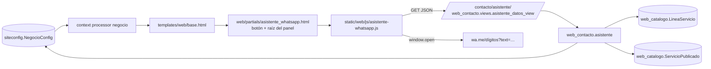

# VCF-WEB · Design · Asistente de WhatsApp

| Versión | Fecha | Estado |
|---|---|---|
| v2 | 2026-10-23 | Aprobado por el Gerente (modo rápido) · cambio de alcance v1.5 del HU |

## Componentes



## Modelo de datos
`siteconfig.NegocioConfig`:
- Campos nuevos (migración `0008`): `horario_semana_receso_inicio` y `horario_semana_receso_fin` (TimeField, null), para el corte de mediodía de lunes a viernes. La migración `0009` carga 13:00 y 15:00 en la fila pk=1.
- `whatsapp_digitos` (propiedad): `whatsapp` reducido a dígitos, para `wa.me`.
- `horario_texto()`: texto humano del horario, por ejemplo "lunes a viernes de 8:00 a 13:00 y de 15:00 a 18:00, sábados de 8:00 a 13:00".
- `esta_abierto(momento)`: `True` si `momento` (convertido a America/Lima) cae dentro del horario. El domingo siempre está cerrado.

No se crean modelos nuevos. No se toca ningún modelo del LIMS (regla 1 de `CLAUDE.md`).

## Endpoint
`GET /contacto/asistente/` (`web_contacto:asistente_datos`), solo en `urls_web.py`. Responde JSON:

```json
{
  "saludo": "Buenas tardes",
  "abierto": true,
  "horario": "lunes a viernes de 8:00 a 13:00 y de 15:00 a 18:00, sábados de 8:00 a 13:00",
  "whatsapp": "51964326364",
  "lineas": [
    {"nombre": "…", "resumen": "…", "url": "/servicios/<slug>/",
     "slug": "<slug>",
     "ensayos": [{"titulo": "…", "resumen": "…", "slug": "<slug>", "url": "/servicios/<slug>/" | null}]}
  ]
}
```
- *(v2)* `slug` es la clave estable con la que el JS guarda el paso en `sessionStorage` (ya es público: forma parte de la URL). `url` es `null` cuando la página no está publicada (REQ-WEB-21): un ensayo cuyo slug coincide con el de una línea activa nunca llega a su página, porque `servicio_detalle_view` resuelve primero `LineaServicio`. Las líneas listadas siempre son activas, así que su `url` existe.
- Lista blanca con `.values()` y `.only()`: no salen precio, código, acreditado ni `servicio_id` (regla 2 de `CLAUDE.md`).
- El catálogo se cachea 5 minutos (`asistente:catalogo:v2`; en v2 cambió la clave porque cambió el formato). El saludo y `abierto` se calculan en cada request con `timezone.localtime()` (`TIME_ZONE = 'America/Lima'`), y la respuesta lleva `Cache-Control: no-store`.
- Solo GET (`require_GET`). Si no hay `NegocioConfig` o falta el WhatsApp, responde 404.

## Plantillas
- `templates/web/partials/asistente_whatsapp.html`: `<a>` flotante a `wa.me/<dígitos>` (funciona sin JS), raíz `#asistente-wa` con `role="dialog"` y `data-endpoint`, y el `<script defer>` del JS. Va dentro de ``.
- `templates/web/base.html`: incluye el partial una vez para todas las páginas.
- `templates/web/home.html`: se quita el botón flotante propio (pasa al partial) y el horario muestra el receso.
- `templates/web/contacto.html`: usa `negocio.whatsapp_digitos` en lugar de la cadena de `cut`.

## JavaScript (`static/web/js/asistente-whatsapp.js`)
- Máquina de pasos sin dependencias. Los textos T-01 a T-40 van como constantes (sección 7 del HU, aprobados en G1).
- Funciones puras exportadas en `window.VicafAsistente` y en `module.exports` para testearlas con `node --test`: `armarMensajeCotizacion`, `armarMensajeServicio`, `armarMensajeAsesor`, `urlWhatsapp`, `validarCantidad`, `ubicacionExcluida`.
- Estado: `respuestas = {nombre, empresa, servicio, cantidad, ubicacion}`, en un solo objeto, listo para la opción C.
- Accesibilidad: el panel tiene `aria-modal="false"` y el foco va al primer control; Esc cierra; los botones son `<button>` reales.
- Estilos: clases Tailwind ya presentes en el proyecto. `tailwind.config.js` ya escanea `static/web/js/**/*.js`.

## v2 · Navegación con el panel abierto (REQ-WEB-20 a 29)

### Estado en el navegador
Clave `sessionStorage['vicaf:asistente-wa']`, JSON versionado:

```json
{"v": 1, "abierto": true,
 "pila": [{"p": "menu"}, {"p": "lineas"}, {"p": "linea", "linea": "mecanica-de-suelos"},
          {"p": "ensayo", "linea": "mecanica-de-suelos", "ensayo": "ensayo-cbr"}],
 "respuestas": {"nombre": "…", "empresa": "", "servicio": "Ensayo CBR", "servicioPreelegido": true,
                "cantidad": "", "ubicacion": ""}}
```

- La pila de pasos deja de ser una pila de funciones (v1) y pasa a ser una lista de objetos `{p, …params}` serializables. Un registro `PASOS[p]` pinta cada uno. Pasos: `menu`, `lineas`, `linea`, `ensayo`, `asesor`, `fuera` (aviso T-40, guarda el mensaje y si viene de la cotización), `nombre`, `empresa`, `servicio`, `servicioOtro`, `cantidad`, `ubicacion`, `resumen`, `enviado`.
- Se guarda en cada cambio de paso, al abrir, al cerrar y al validar una respuesta. Lo que el visitante escribió y aún no envió en un campo no se guarda.
- Funciones puras nuevas, probadas con `node --test`: `estadoInicial`, `serializarEstado`, `leerEstado` (descarta JSON roto, versiones distintas y pasos desconocidos), `podarPila` (REQ-WEB-24: corta la pila en el primer paso cuya línea o ensayo ya no existe y garantiza `menu` en la base) y `enlaceWeb` (solo acepta rutas relativas `/servicios/<slug>/`; `null` en otro caso).
- Acceso a `sessionStorage` siempre en `try/catch` (REQ-WEB-29).

### Ciclo de vida
1. `DOMContentLoaded`: lee el estado. Si `abierto`, abre el panel sin mover el foco (REQ-WEB-22), pide el endpoint y pinta el último paso de la pila podada.
2. Botón flotante: abre y pinta el último paso, o el menú si no hay estado (REQ-WEB-04). El foco va al primer control, como en v1.
3. `×` o Esc: `abierto = false`, se guarda y se devuelve el foco al botón (REQ-WEB-27). La pila se conserva para retomar.
4. "Ver en la web" es un `<a href>` normal, sin `target`, en la misma pestaña. Como el estado ya está guardado, la página siguiente lo restaura.
5. "Menú principal" (`[data-asistente-menu]`, en la cabecera) se oculta en el paso `menu` y en los demás lleva a `menu` vaciando la pila (REQ-WEB-25).

### Móvil (REQ-WEB-28)
- El contenedor pasa a `fixed inset-x-4 bottom-4` en `< sm` (16 px de margen) y a `bottom-5 right-5` desde `sm`. Lleva `pointer-events-none` y sus hijos `pointer-events-auto`, para que la franja vacía no tape toques sobre la página.
- El área de mensajes: `max-h-[40vh]` en móvil y `sm:max-h-[min(28rem,70vh)]` en escritorio. `overscroll-contain`, para que el scroll del panel no arrastre a la página.
- Con el panel abierto en móvil, el contenedor lleva `data-abierto="true"` y el botón flotante se oculta (`max-sm:group-data-[abierto=true]:hidden`). La cabecera ya tiene ×.
- `body.style.paddingBottom` = alto del panel + 16 px mientras está abierto en `< 640 px` (`matchMedia`, recalculado con `ResizeObserver`). Así el final de cualquier página se puede leer por encima del panel. Se restaura al cerrar.
- No hay capa ni `aria-modal`: la página sigue siendo usable con el panel abierto.

### Reglas de `CLAUDE.md` que aplican
- 2 y 3 (lista blanca): el payload solo suma `slug`, que ya es público. Sigue sin salir precio, código, acreditado ni `servicio_id`.
- 15 (`noindex`): no cambia, el asistente no crea URLs nuevas.
- 17 (rendimiento): JS `defer`, sin dependencias nuevas, sin peticiones extra salvo el endpoint cuando el panel se restaura abierto.

## Riesgos
| Riesgo | Mitigación |
|---|---|
| Caché de 5 min: un cambio en el admin tarda en verse en el asistente | Aceptable; se documenta |
| *(v2)* El paso guardado apunta a algo despublicado | `podarPila` cae al paso válido más cercano (REQ-WEB-24) |
| *(v2)* Datos del visitante (nombre, empresa) en `sessionStorage` | Solo en su navegador y en esa pestaña; se borran al cerrarla; nunca van al servidor (RN-12) |
| *(v2)* En móvil el panel ocupa la mitad inferior | Altura limitada, sin capa, y `padding-bottom` en `body` para leer todo el contenido; × siempre visible |
| Ventanas emergentes bloqueadas en `window.open` | Se usa un `<a target="_blank">` real en el último paso, así que el clic es del usuario |
| Validación de ubicación con texto libre (P-03) | Lista de D-VCF-002 y sufijo ", Cajamarca" |
| El CSS se compila con Tailwind (`output.css` está en `.gitignore`) | Correr `npm run build:css` o el contenedor `node` |
